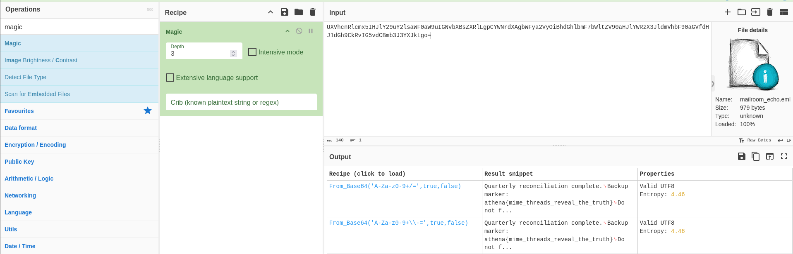

## Mailroom Echo

**Category:** Forensics  
**Difficulty:** Easy

### Objective
Uncover the flag hidden in the email message.

### Solution

I opened `mailroom_echo.eml` to inspect the email content and look for suspicious text or encoded data.

A hidden token was found at the bottom of the message. I copied the token into CyberChef and decoded it to reveal the flag.

**Flag:** `athena{mime_threads_reveal_the_truth}`

### Lessons Learned
- Email files (`.eml`) may contain hidden information in their message content.
- Encoded strings can be identified and decoded using CyberChef.
- Basic file inspection is an effective first step in forensic analysis.