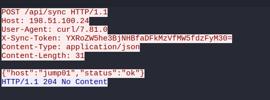
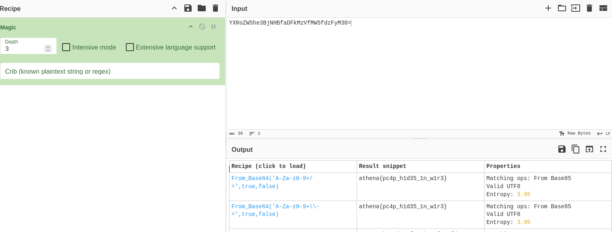

## PCAP Secret

**Category:** Forensics  
**Difficulty:** Easy

### Objective
Analyze a PCAP file to uncover the flag.

### Solution

I opened `forensic_pcap_secret.pcap.gg` in Wireshark to analyze the captured traffic and look for unusual external communication.

I noticed a suspicious IP address, `198.51.100.24`, and followed the HTTP stream to inspect the request. The `X-Sync-Token` header contained an encoded token.

I copied the token value into CyberChef and decoded it to reveal the flag.

**Flag:** `athena{pc4p_h1d35_1n_w1r3}`

### Lessons Learned
- PCAP files can contain sensitive information hidden in network traffic.
- HTTP headers may contain custom fields that expose tokens or secrets.