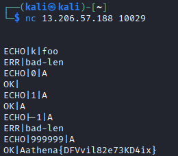

## Net Custom Protocol

**Category:** Infra  
**Difficulty:** Easy

### Objective
Reverse the custom TCP echo protocol and identify a flaw that leaks the hidden secret.

### Solution

I launched the challenge instance and connected to it using Netcat.

The provided protocol transcript was `ECHO|k|foo`. From this example, I identified three fields separated by `|`: the command (`ECHO`), the message length, and the message content.

I tested different length values to understand how the server validated the input.

First, I sent a request with a length of `0`.

```text
ECHO|0|A
```

The server returned `Bad Length`, indicating that the value was rejected.

Next, I tested a length of `1`.

```text
ECHO|1|A
```

The server returned `OK`, confirming that the request was accepted.

I then tested a negative length.

```text
ECHO|-1|A
```

The server rejected the request, showing that negative values were not accepted.

Finally, I tested an excessively large length.

```text
ECHO|999999|A
```

Instead of rejecting the request, the server returned memory contents containing the hidden challenge secret, revealing the flag.

**Flag:** `athena{DFVvil82e73KD4ix}`



### Lessons Learned
- Read protocol transcripts to understand the expected message format.
- Fuzzing input fields helps identify unexpected server behavior.
- Testing boundary values can expose validation flaws.
- Improper length handling can lead to memory disclosure.