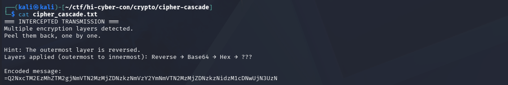
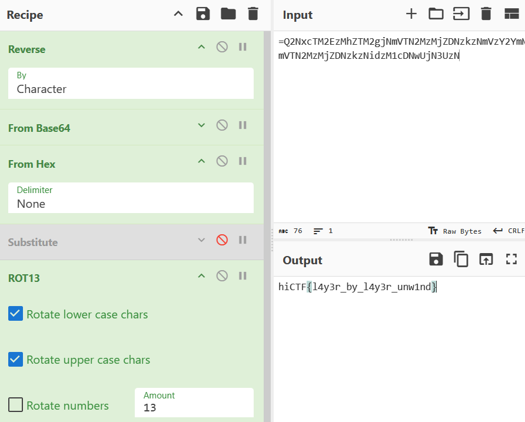

<!-- WVVoU01HTklUVFpNZVRsdVlWaFNiMlJYU1hWWk1qbDBUREkwZEZsWFduQmpWMFYyWkROS2NHUkhWakZqU0UwOQ== -->

## Cipher Cascade

### Objective
Decrypt the message with multiple layers of encoding.

### Solution

#### 1. Analyze the file type of the provided zip file

```bash
file cipher-cascade.zip
```
The file command output the type of the file, which is a zip archive.

#### 2. Unzip the file to extract the contents.

```bash
unzip cipher-cascade.zip
```
`cipher-cascade.txt` is extracted from the zip file.

#### 3. Check the contents of the cipher-cascade.txt

View the file contents.



#### 4. Analyze the content of the file.

There was hint in the file contents how to descrypt the message by applying multiple layer of encoding to apply multiple layers of encoding. The first three was given which was Reverse -> Base 64 -> Hex.

#### 5. Decode the message

Copy the encrypted and paste it on Cyberchef, by applying the first three layers of encoding. The output of these three layers encoding suggested that the next encoding could be ROT13 as the flag format is `hiCTF{...}`.

#### 6. Capture the flag

Apply ROT13 to the output of the previous step, and to get the final flag.



**Flag:**  hiCTF{l4y3r_by_l4y3r_unw1nd}

### Lessons Learned
- Multiple layers of encoding can be used to obfuscate a message.
- Knowing the encoding patterns and how to reverse them is crucial in cryptography challenges.

---

<div align="center">
  <sub> Created by <a href="https://github.com/n-afiqa/">@n-afiqa</a> · © 2026.</sub>
</div>
