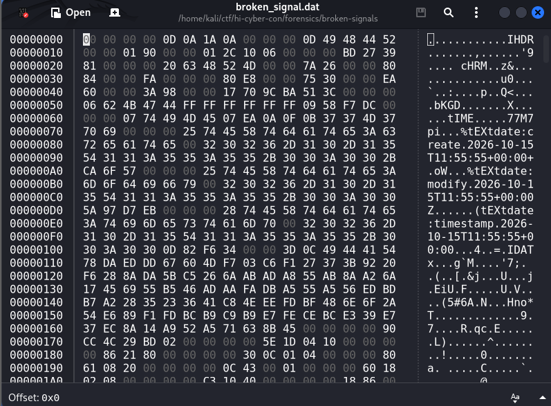
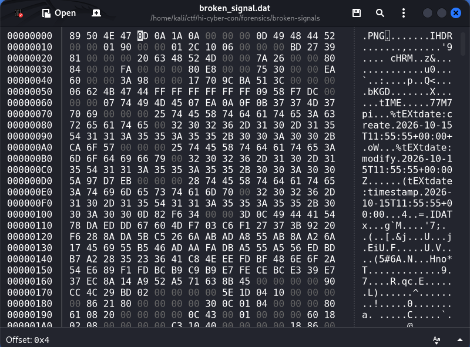
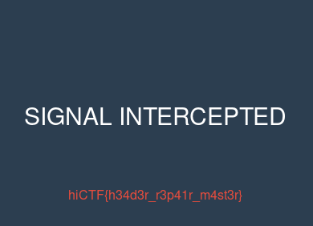

<!-- WVVoU01HTklUVFpNZVRsdVlWaFNiMlJYU1hWWk1qbDBUREkwZEZsWFduQmpWMFYyWkROS2NHUkhWakZqU0UwOQ== -->

## Broken Signals

### Objective
Repair and recover the corrupted signal to retrieve the secret flag.

### Solution

#### 1. Analyze the file type of the provided zip file

```bash
file broken-signals.zip
```
The file command output the type of the file, which is a zip archive.

#### 2. Unzip the file to extract the contents.

```bash
unzip broken-signals.zip
```
`broken-signals.dat` is extracted from the zip file.

#### 3. Analyze the file type and the metadata of the broken-signals.dat

```bash
file broken-signals.dat
exiftool broken-signals.dat
```
It was revealead the the file type is a PNG image.

Since the file and image file, I tried to open the file using an image viewer, but it was corrupted and could not be opened.


#### 4. Check the file header of the broken-signals.dat

```bash
xxd broken-signals.dat | head -n 1
```
The hex showed that the file header was `00 00 00 00 0D 0A 1A 0A`, which is not a valid PNG file header. The valid PNG file header should be `89 50 4E 47 0D 0A 1A 0A`. This indicates that the first 4 bytes of the file header were corrupted and need to be repaired to restore the PNG file.



#### 5. Repair the file header

Edit the file header with hex editor and replace the first 4 bytes with `89 50 4E 47` to repair the PNG file header.



#### 6. View the repaired image

After repairing the file header, I was able to open the image using an image viewer. The image contained the secret flag.



**Flag:** hiCTF{h34d3r_r3p41r_m4st3r}

### Lessons Learned
- Corrupted file headers can prevent files from being opened or recognized correctly.
- Knowing the correct file header format is essential for repairing corrupted files.

---

<div align="center">
  <sub> Created by <a href="https://github.com/n-afiqa/">@n-afiqa</a> · © 2026.</sub>
</div>
