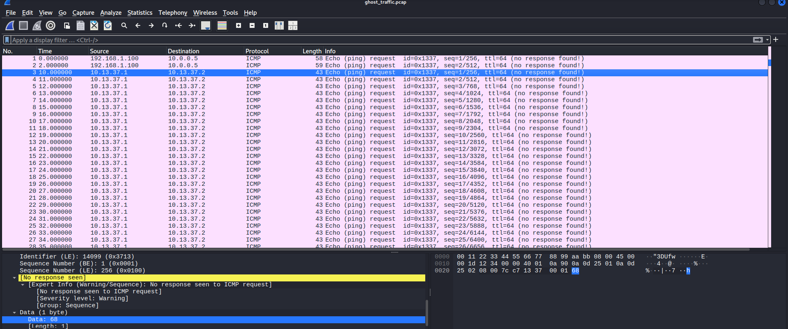

<!-- WVVoU01HTklUVFpNZVRsdVlWaFNiMlJYU1hWWk1qbDBUREkwZEZsWFduQmpWMFYyWkROS2NHUkhWakZqU0UwOQ== -->

## Ghost in the Wire

### Objective
Analyze the ICMP traffic to retrieve the secret flag.

### Solution

#### 1. Analyze the file type of the provided zip file

```bash
file ghost-in-the-wire.zip
```
The file command output the type of the file, which is a zip archive.

#### 2. Unzip the file to extract the contents.

```bash
unzip ghost-in-the-wire.zip
```
`ghost-in-the-wire.pcap` is extracted from the zip file.

#### 3. Analyze ghost-in-the-wire.pcap

```bash
wireshark ghost-in-the-wire.pcap
```

First , I apply a filter to view only public IP addresses in the packet capture, but found nothing. Next, I tried sorting the packets based on their length, but it was revealed that the packets almost similar in length, which ranges from 43-59 bytes. 

After looking at the packets, I found that there is a lot of traffic going from `10.13.37.1` to `10.13.37.2`, and started to inspect the packets to check if there is any hidden data in the ICMP traffic. After inspecting the packets, I found that there is a hidden data in the ICMP traffic, whereby a character was sent one by one in the ICMP traffic, and the data was sent in a sequence of 1-2-3-4...., which is the order of the packets.



#### 4. Capture the hidden data in the ICMP traffic

I continued extracting the hidden characters in the ICMP traffic, and after extracting all the hidden characters, I was able to retrieve the secret flag.

**Flag:** hiCTF{1cmp_3xf1l_d3t3ct3d}

### Lessons Learned
- ICMP traffic can be used to exfiltrate data, and it is important to monitor and analyze network traffic for any suspicious activity.
- A hidden data can be exfiltrated in form of small packets
- Knowing how to reconstruct the packtes and analyze the traffic is important in forensic challenges.

---

<div align="center">
  <sub> Created by <a href="https://github.com/n-afiqa/">@n-afiqa</a> · © 2026.</sub>
</div>
