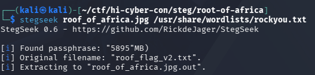

<!-- WVVoU01HTklUVFpNZVRsdVlWaFNiMlJYU1hWWk1qbDBUREkwZEZsWFduQmpWMFYyWkROS2NHUkhWakZqU0UwOQ== -->

## Roof of Africa

### Objective
Uncover the hidden message in the provided image.

### Solution

#### 1. Analyze the file type of the provided zip file

```bash
file roof-of-africa.zip
```
The file command output the type of the file, which is a zip archive.

#### 2. Unzip the file to extract the contents.

```bash
unzip roof-of-africa.zip
```
`roof-of-africa.jpg` is extracted from the zip file.

#### 3. View the image

I used image view to view the image. The image is not broken, so I can proceed to analyze the image to find the hidden message.

#### 4. Analyze the image for hidden data

I use stegseek to analyze the image for hidden data. But, it need password to extract the hidden data. So, I brute force with a rockyou.txt  wordlist to find the password.

```bash
stegseek roof-of-africa.jpg /usr/share/wordlists/rockyou.txt
```




#### 4. Retrieve the flag

View the extracted hidden data, and found the secret flag.

**Flag:** hiCTF{h4kun4_m4t4t4_m34ns_n0_w0rr13s}

### Lessons Learned
- Stegseek is a tool that can be used to extract hidden data from JPG/JPEG images, but it requires a password to extract the hidden data.

---

<div align="center">
  <sub> Created by <a href="https://github.com/n-afiqa/">@n-afiqa</a> · © 2026.</sub>
</div>