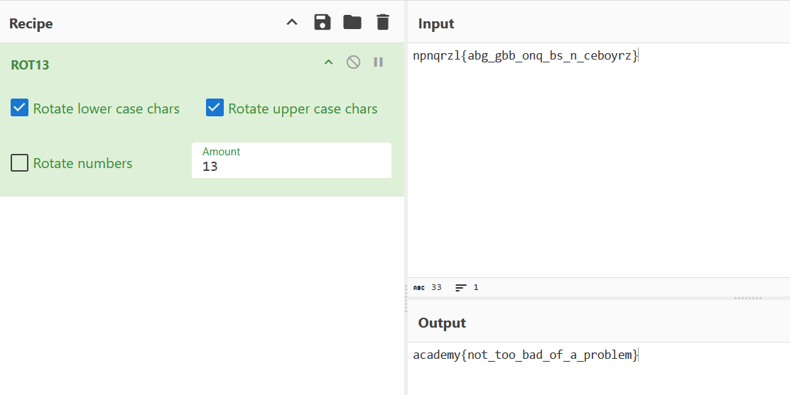

## 13

### Objective:
Decode the ROT13-encrypted text to reveal the flag.

### Solution:
Paste the encrypted text `npnqrzl{abg_gbb_onq_bs_n_ceboyrz}` into CyberChef and apply the ROT13 operation to decode the flag.

**Flag:** `academy{not_too_bad_of_a_problem}`

### Lessons Learned:
The challenge hinted at ROT13, so recognising the hint helped identify the correct decoding method.