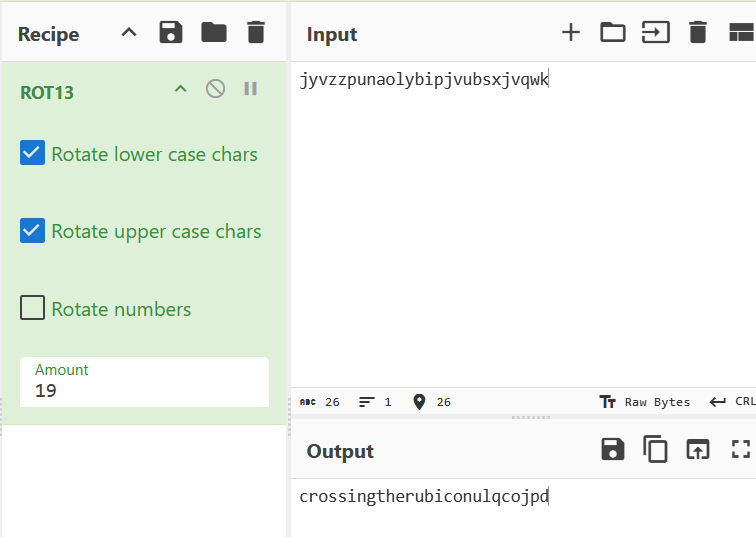

## caesar

### Objective:
Decrypt the message to reveal the flag.

### Solution:
I started by checking the contents of `data.enc`, which displayed `academy{jyvzzpunaolybipjvubsxjvqwk}`.

Since the text appeared to use letter substitution, I tried ROT13 in CyberChef to check whether it would reveal a meaningful message.

I pasted the encoded text `jyvzzpunaolybipjvubsxjvqwk` into CyberChef and applied ROT13.

**Flag:** `academy{crossingtherubiconulqcojpd}`

### Lessons Learned:
The challenge name *Caesar* suggested a Caesar cipher. Trying ROT13 was a reasonable first step because it is a common Caesar cipher variant that shifts letters by 13 positions.