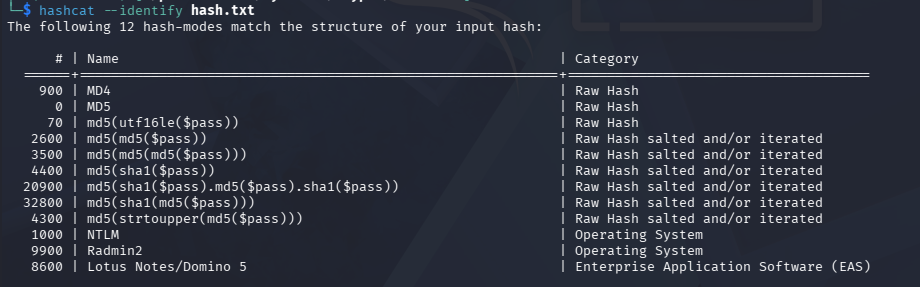
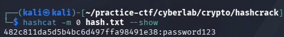
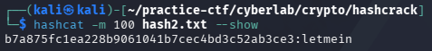
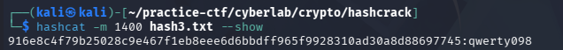

## hashcrack

### Objective:
Crack the hash to uncover the flag.

### Solution:
Upon launching the instance, a hash string was provided. I opened another terminal and saved the hash into `hash.txt`.

I ran `hashcat --identify hash.txt` to identify the hash type. From the output, MD5 was listed as a possible match.

Next, I ran `hashcat -m 0 hash.txt /usr/share/wordlists/rockyou.txt` to crack the hash using MD5 and the `rockyou.txt` wordlist. I then used `hashcat -m 0 hash.txt --show` to view the cracked password, which was `password123`.

I pasted the password into the running Netcat terminal, which displayed another hash. I saved this second hash as `hash2.txt` and repeated the process using `hashcat -m 100 hash2.txt /usr/share/wordlists/rockyou.txt`, followed by `hashcat -m 100 hash2.txt --show`. The second password was `letmein`.

After entering the second password into the Netcat terminal, a third hash appeared. I saved it as `hash3.txt` and ran `hashcat -m 1400 hash3.txt /usr/share/wordlists/rockyou.txt` to crack it, followed by `hashcat -m 1400 hash3.txt --show` to display the recovered password.

After entering the third password into the Netcat terminal, the flag was revealed:
`academy{UseStr0nGh@shEs&PaSswDs!_a8894b1b}`

### Lessons Learned:
- Use `hashcat --identify` to help identify an unknown hash type.
- Hashcat uses different mode numbers for different algorithms: `-m 0` for MD5, `-m 100` for SHA-1, and `-m 1400` for SHA-256.
- Dictionary attacks use wordlists such as `rockyou.txt` to find passwords that match a given hash.
- Hash cracking can involve multiple stages, where each recovered password unlocks the next hash until the flag is revealed.