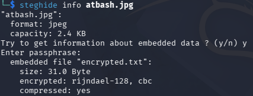
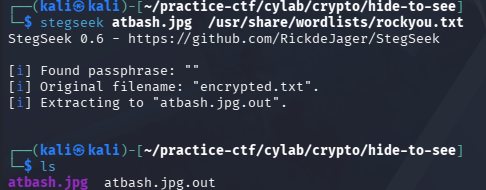

## HideToSee

### Objective:
Find the hidden file embedded in an image.

### Solution:
I started by inspecting the image metadata using `exiftool atbash.jpg`, but nothing useful was found. I then ran `steghide info atbash.jpg` to check for embedded data, which confirmed that `encrypted.txt` was hidden inside `atbash.jpg`.



Since a passphrase was required to extract the file, I used Stegseek to crack it with the rockyou wordlist.

```bash
stegseek atbash.jpg /usr/share/wordlists/rockyou.txt
```



The extracted file, `atbash.jpg.out`, contained `zxzwvnb{zgyzhs_xizxp_wxyx498z}`.

Since the text did not match the expected `academy{...}` flag format, I suspected a substitution cipher because `zxzwvnb` could be transformed into `academy` with the correct letter substitution. The challenge name `HideToSe` also hinted at steganography, while the filename `atbash.jpg` suggested the Atbash cipher.

I pasted the extracted text into CyberChef and used the **Substitute** operation with the following mappings, enabling *Ignore Case*:

- **Plaintext:** `ZYXWVUTSRQPONMLKJIHGFEDCBA`
- **Ciphertext:** `ABCDEFGHIJKLMNOPQRSTUVWXYZ`

This decoded the text into the flag.

**Flag:** `academy{atbash_crack_dcbc498a}`

### Lessons Learned:
- File metadata inspection may not reveal hidden data, so tools like Steghide can help identify embedded files. 
- Stegseek can recover passphrases using a wordlist, and filenames or challenge names can provide useful hints about the cipher used to decode extracted content.