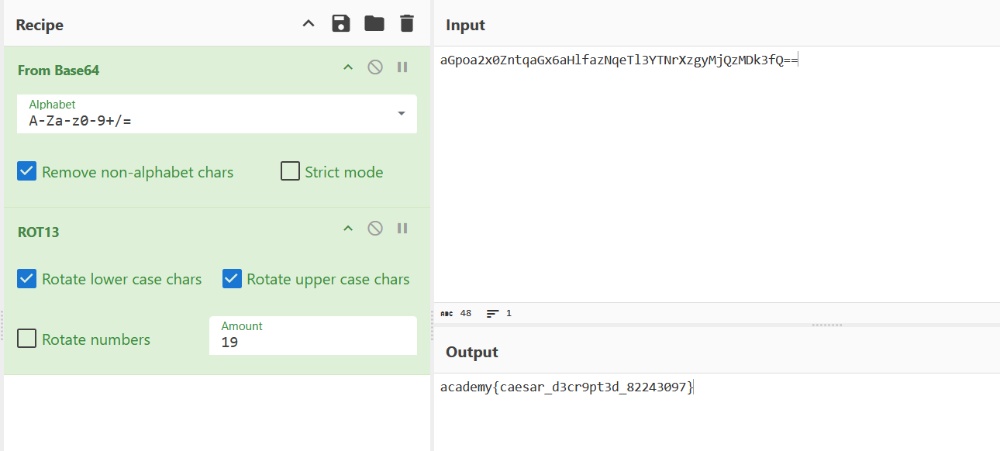

## interendec

### Objective:
Decode the text to reveal the flag.

### Solution:
I checked the contents of `enc_flag`, which contained:

`YidhR3BvYTJ4MFpudHFhR3g2YUhsZmF6TnFlVGwzWVROclh6Z3lNalF6TURrM2ZRPT0nCg==`

Based on its pattern, I identified it as Base64-encoded text and used CyberChef to decode it. The output was:

`b'aGpoa2x0ZntqaGx6aHlfazNqeTl3YTNrXzgyMjQzMDk3fQ=='`

The output contained another Base64-encoded string. I removed the `b'` prefix and closing `'` and decoded it again, obtaining:

`hjhkltf{jhlzhy_k3jy9wa3k_82243097}`

Since the decoded text was still unreadable, I tried ROT13. When the result did not produce the expected flag, I increased the rotation amount to 19, which revealed the flag.

**Flag:** `academy{caesar_d3cr9pt3d_82243097}`

### Lessons Learned:
- Cryptography challenges may involve multiple layers of encoding and encryption, requiring several decoding steps.
- ROT ciphers can use different rotation amounts, so trying ROT13 alone may not be enough.