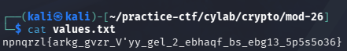

## Mod 26

### Objective:
Decode the text using ROT13.

### Solution:
I checked the contents of `values.txt`, which contained `npnqrzl{arkg_gvzr_V'yy_gel_2_ebhaqf_bs_ebg13_5p5s5o36}`.

I pasted the encoded text into CyberChef and applied ROT13 to decode the flag.

**Flag:** `academy{next_time_I'll_try_2_rounds_of_rot13_5c5f5b36}`

### Lessons Learned:
Challenge descriptions can contain hints about the intended solution. Recognizing and interpreting these hints can help identify the correct decoding method faster.