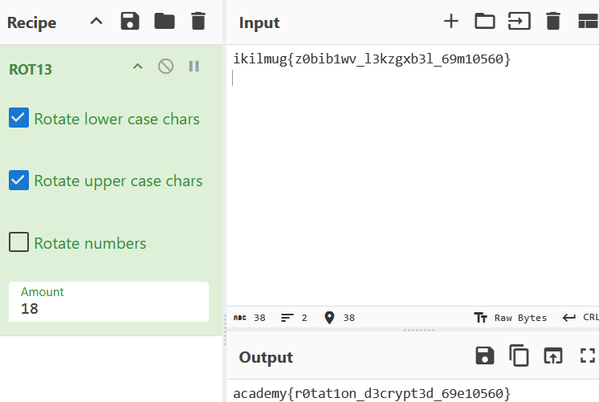

## rotation

### Objective:
Decrypt the text using a ROT cipher.

### Solution:
I checked the contents of `encrypted.txt`, which contained `ikilmug{z0bib1wv_l3kzgxb3l_69m10560}`, and pasted the text into CyberChef.

Since the challenge title was `rotation`, I tried the ROT13 operation first, then increased the rotation amount until the output matched the expected flag format, `academy{...}`.

**Flag:** `academy{r0tat1on_d3crypt3d_69e10560}`

### Lessons Learned:
- ROT ciphers can use different rotation amounts, not just 13.
- Challenge titles can provide useful hints about the intended solution.