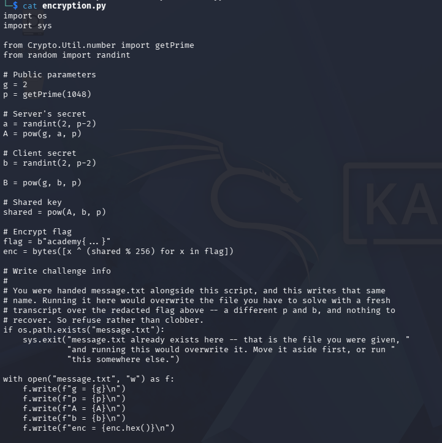

## Shared Secrets

### Objective:
Decrypt the leaked secrets.

### Solution:
I started by checking `message.txt` and `encryption.py` to understand how the message was generated.

`enc = bytes([x ^ (shared % 256) for x in flag])`

From the code, `enc` contains the encrypted flag, generated using XOR:
`encrypted_byte = flag_byte XOR key`

Using this formula, I decrypted the message with a Python script. Running [`python3 solve.py`](scripts/solve.py)recovered the flag:
`academy{dh_s3cr3t_5d9c8fbe}`

### Lessons Learned:
Some challenges require a custom script to decrypt a message.