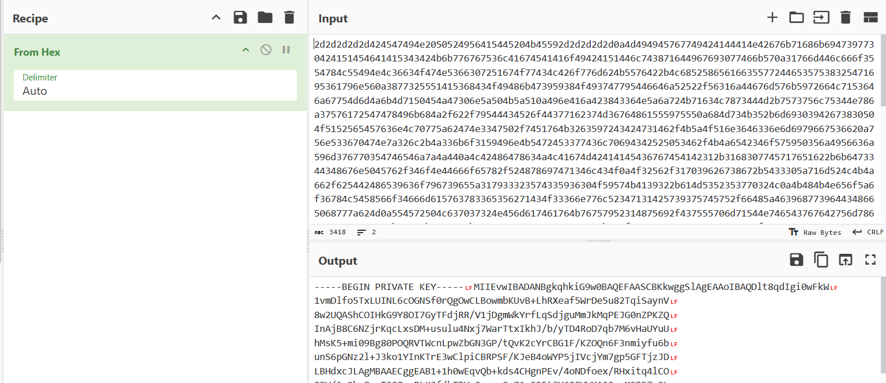

## StegoRSA

### Objective:
Decrypt the message to recover the hidden private key.

### Solution:
I first checked `flag.enc` using ExifTool and `strings`, but found nothing useful. I then inspected `image.jpg` with `exiftool image.jpg` and discovered encrypted text in the comment section.

The text contained only numbers and characters from `a` to `f`, suggesting it was hexadecimal. Using CyberChef's **From Hex** operation with the delimiter set to **Auto**, I decoded the text and saved the recovered private key as `private.pem`.

With the private key recovered, I used OpenSSL to decrypt the encrypted flag:
`openssl pkeyutl -decrypt -inkey private.pem -in flag.enc -out flag.txt`

The flag was saved in `flag.txt` 
`academy{tr45h_51ng1ng_d99a9ef4}`

### Lessons Learned:
- RSA encryption uses a public–private key pair: the public key encrypts the message, while the private key decrypts it.
- OpenSSL can use the recovered RSA private key to decrypt the encrypted file.