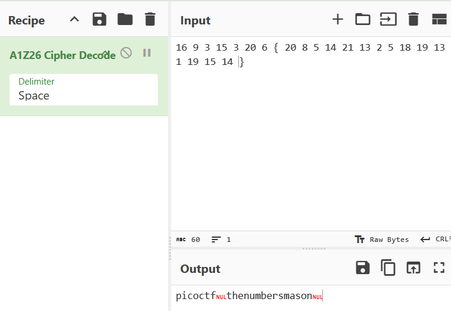

## The Numbers

### Objective:
Decrypt the text shown in the image.

### Solution:
I started by inspecting the file using `exiftool the_numbers.png` and `zsteg the_numbers.png`, but neither tool revealed any useful clues.

I then opened the image in an image viewer and found the following string:

`16 9 3 15 3 20 6 20 {8 5 14 21 13 2 5 18 19 13 1 19 15 14}`

Since the text consisted of numbers between 1 and 26, I suspected an A1Z26 cipher, where each number represents a letter's position in the alphabet. I used CyberChef's **A1Z26 Cipher Decode** operation to decode the string.

The result was `picoctf{thenumbersmason}`. Although it used the older `picoCTF` flag format rather than `academy{...}`, the decoded text followed the expected flag structure.

**Flag:** `picoctf{thenumbersmason}`

### Lessons Learned:
- Inspecting an image visually can reveal clues that metadata and steganography tools may not find.
- Number sequences between 1 and 26 can indicate an A1Z26 cipher.