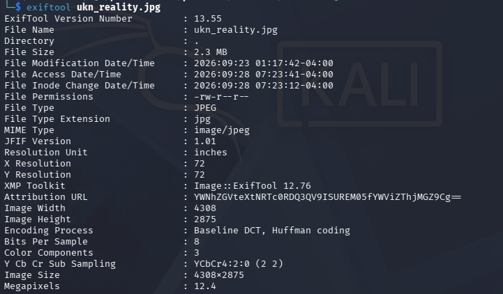

## CanYouSee

### Objective:
Find the hidden flag in file metadata.

### Solution:
I started with `exiftool unknown.zip` to inspect the metadata, which revealed `ukn_reality.jpg` inside the archive. After extracting it with `unzip unknown.zip`, I inspected the image using `exiftool ukn_reality.jpg` and found encoded text `YWNhZGVteXtNRTc0RDQ3QV9ISUREM05fYWViZThjMGZ9Cg==` in the metadata.

I pasted the encoded text into CyberChef and used Magic to decode it, revealing the flag:

`academy{ME74D47A_HIDD3N_aebe8c0f}`

### Lessons Learned:
Hidden data may appear as encoded text rather than plain text. CyberChef's Magic tool helps identify and decode it quickly.