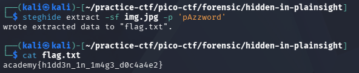

## Hidden in Plain Sight

### Objective:
Find the hidden flag in an image.

### Solution:
I started by inspecting `img.jpg` with ExifTool and found encoded text `c3RlZ2hpZGU6Y0VGNmVuZHZjbVE9` in the metadata.

Using CyberChef's Magic tool, I decoded the text and got `steghide:cEF6endvcmQ=`. After removing `steghide:` and decoding the remaining text, I obtained `pAzzword`. This wasn't the flag, but the `steghide` hint suggested that more data was hidden in the image.

I used the password to extract the hidden file:
`steghide extract -sf img.jpg -p 'pAzzword'`

This extracted `flag.txt`, which contained the flag:
`academy{h1dd3n_1n_1m4g3_d0c4a4e2}`

### Lessons Learned:
- Encoded text may require multiple decoding steps.
- Steghide can extract hidden data from images when the correct password is provided.