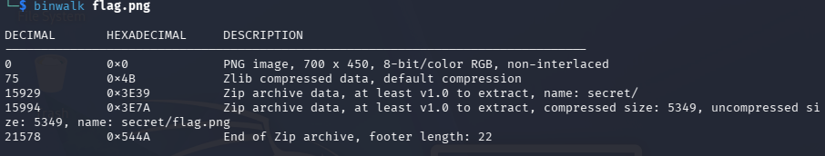

## hideme

### Objective:
Inspect a PNG file to uncover hidden content.

### Solution:
I started with `exiftool flag.png`, but the metadata revealed nothing useful. I then ran `binwalk flag.png` and discovered that the PNG contained embedded files, including `secret/flag.png`.

Using `binwalk -Me flag.png`, I extracted the hidden files. Inspecting `secret/flag.png` with ExifTool finally revealed the flag:

`academy{Hiddinng_An_imag3within@n_ima9e_c55a7afe}`

### Lessons Learned:
File extensions can be misleading. Binwalk helps uncover embedded files, while ExifTool can reveal useful metadata.