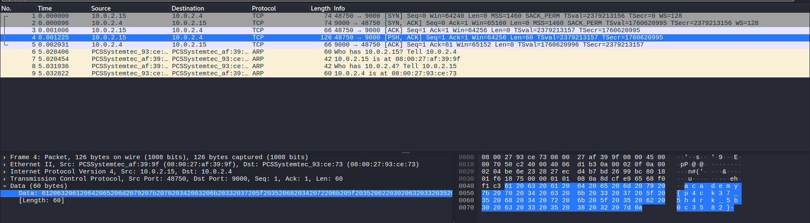

## Packets Primer

### Objective:
Analyze a PCAP file to uncover the flag.

### Solution:
I opened `network-dump.flag.pcap` in Wireshark to inspect the network traffic.

One packet had an unexpectedly larger length than the others.

After inspecting the packet's data section, I found the flag:
`academy{p4ck37_5h4rk_5b0c3582}`

### Lessons Learned:
Inspecting packet lengths can help identify unusual network traffic and uncover hidden data.