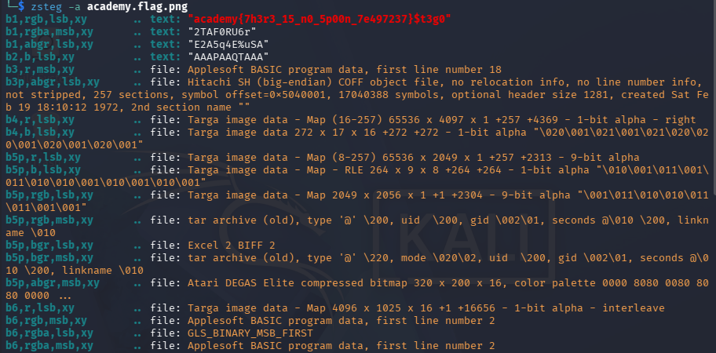

## St3g0

### Objective:
Inspect a PNG file to uncover hidden content.

### Solution:
I started by checking `academy.flag.png` with ExifTool, but the metadata revealed nothing useful. I then used `zsteg -a academy.flag.png` to check for hidden data, and the output revealed the flag.

`academy{7h3r3_15_n0_5p00n_7e497237}`

### Lessons Learned:
Tools like zsteg can uncover hidden data in image files that ordinary metadata inspection may miss.