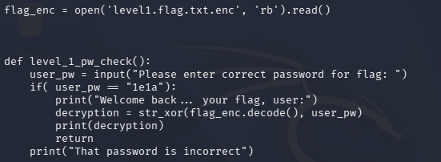
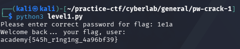

## PW Crack 1

### Objective:
Crack the password to retrieve the flag.

### Solution:
I read `level1.py` to understand how the program works and determine the correct password.

Based on the code, the correct password is `1e1a`. I ran `python3 level1.py` and entered `1e1a` when prompted for the password to retrieve the flag.

`academy{545h_r1ng1ng_4a96bf39}`

### Lessons Learned:
- Reading source code helps identify hardcoded passwords and understand how a program validates user input.