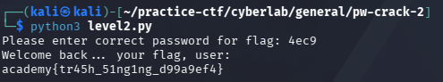

## PW Crack 2

### Objective:
Crack the password to retrieve the flag.

### Solution:

I read `level2.py` to understand how the program works and determine the correct password.

Based on the code, the password is defined in the `user_pw` variable using `chr()` to convert hexadecimal values into their corresponding ASCII characters:

`user_pw == chr(0x34) + chr(0x65) + chr(0x63) + chr(0x39)`

I referred to the [ASCII table](https://en.cppreference.com/w/c/language/ascii) to identify the characters represented by each hexadecimal value:

- `0x34` → `4`
- `0x65` → `e`
- `0x63` → `c`
- `0x39` → `9`

Therefore, the correct password is `4ec9`.

I ran `python3 level2.py` and entered `4ec9` when prompted for the password to retrieve the flag.

`academy{tr45h_51ng1ng_d99a9ef4}`

### Lessons Learned:
- Python's `chr()` converts an integer code point into its corresponding character. Hexadecimal values can be used as input by prefixing them with `0x`.
- Combining the characters returned by `chr()` reveals the password, demonstrating how source code can obfuscate a hardcoded password without actually encrypting it.