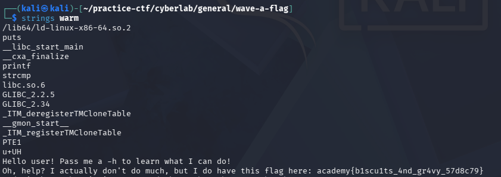

## Wave a Flag

### Objective:
Uncover the flag.

### Solution:

I ran `exiftool warm` to inspect the file metadata. The file was identified as an ELF executable. Since the file contains binary data that is not directly human-readable, I used `strings warm` to extract readable text and uncover the flag.

`academy{b1scu1ts_4nd_gr4vy_57d8c79}`

### Lessons Learned:
- ELF files are executable binaries that can contain readable strings alongside machine code.
- The `strings` command extracts printable text from binary files, which can reveal embedded flags or other useful information.