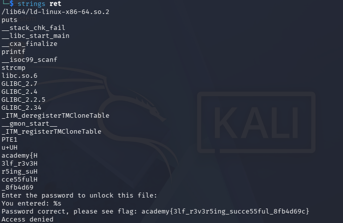

## Reverse

### Objective:
Inspect a file to uncover the hidden flag.

### Solution:
The provided file had no extension, so I used `exiftool ret` to identify its file type. The output revealed that it was an application file.

I then ran `strings ret` to search for readable text, which revealed the flag.

`academy{3lf_r3v3r5ing_succe55ful_8fb4d69c}`

### Lessons Learned:
The `strings` command can reveal useful information hidden in executable files.