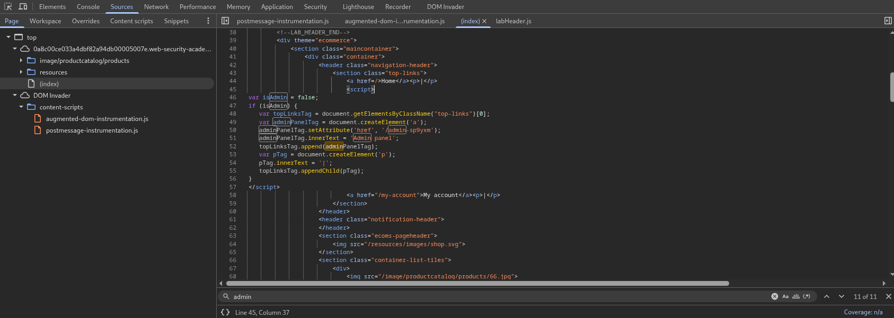
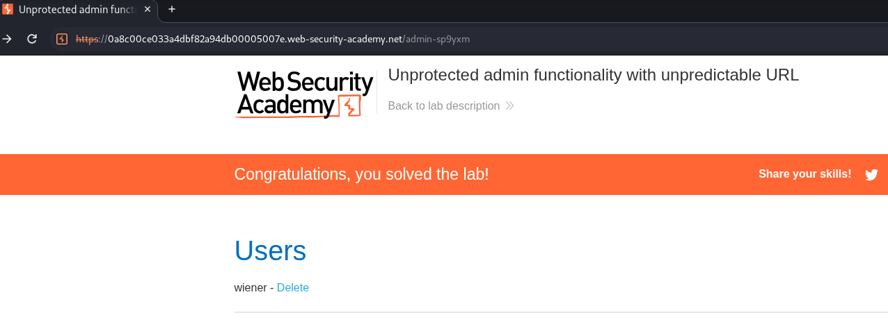

## Lab: Unprotected Admin Functionality with Unpredictable URL

### Objective

Access the administrative panel located at an unpredictable URL and delete the user account `carlos`.

### Vulnerability Analysis

The application exposes administrative functionality without proper access control. A reference to the administrative endpoint is disclosed in a JavaScript file through an HTML anchor element.

### Exploitation

#### 1. Discover the Administrative Endpoint

Inspect the website's page source and search for the keyword `admin`.

The JavaScript file reveals the administrative endpoint `/admin-sp9yxm` through the `href` attribute of `adminPanelTag`.

#### 2. Access the Administrative Panel

Navigate to `/admin-sp9yxm`.

#### 3. Delete the Target Account

Locate the user `carlos` and delete the account.

### Vulnerability

The administrative endpoint is accessible without proper authorization, allowing unauthenticated users to access privileged functionality.

### Remediation

- Enforce server-side authentication and authorization on administrative endpoints.
- Restrict privileged functionality to authorized users.
- Avoid exposing administrative endpoint references in client-side JavaScript where possible.
- Do not rely on unpredictable URLs as an access control mechanism.

### Key Takeaways

- Client-side JavaScript can disclose application endpoints through HTML attributes such as `href`.
- Unpredictable URLs do not provide effective access control.
- Authorization must be enforced server-side.

### CWE References

- [CWE-862 – Missing Authorization](https://cwe.mitre.org/data/definitions/862.html)
- [CWE-284 – Improper Access Control](https://cwe.mitre.org/data/definitions/284.html)