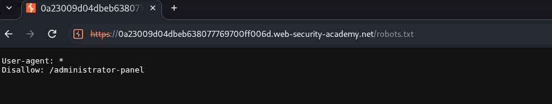
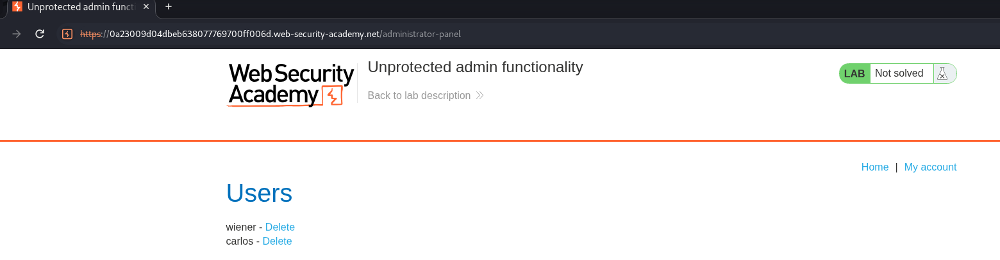

<!-- WVVoU01HTklUVFpNZVRsdVlWaFNiMlJYU1hWWk1qbDBUREkwZEZsWFduQmpWMFYyWkROS2NHUkhWakZqU0UwOQ== -->

## Lab: Unprotected Admin Functionality

### Objective

Access the administrative panel to delete user account `carlos`.

### Vulnerability Analysis

The application exposes administrative functionality without proper access control. The `/robots.txt` file discloses the location of the administrative panel.

### Exploitation

#### 1. Discover the Administrative Endpoint

Navigate to `/robots.txt`.

The file contains a `Disallow` directive for `/administrator-panel`, revealing the administrative endpoint.

#### 2. Access the Administrative Panel

Navigate to `/administrator-panel`.

#### 3. Delete the Target Account

Locate the user `carlos` and delete the account.

### Vulnerability

The administrative endpoint does not enforce proper authorization, allowing unauthenticated users to access privileged functionality.

### Remediation

- Enforce server-side authentication and authorization on administrative endpoints.
- Restrict privileged functionality to authorized users.
- Never rely on `robots.txt` to protect sensitive application paths.

### Key Takeaways

- `robots.txt` can disclose application endpoints.
- Hidden URLs do not provide security.
- Authorization must be enforced server-side.

### CWE References

- [CWE-862 – Missing Authorization](https://cwe.mitre.org/data/definitions/862.html)
- [CWE-284 – Improper Access Control](https://cwe.mitre.org/data/definitions/284.html)

---

   Created by <a href="https://github.com/n-afiqa/">@n-afiqa</a> · © 2026.

