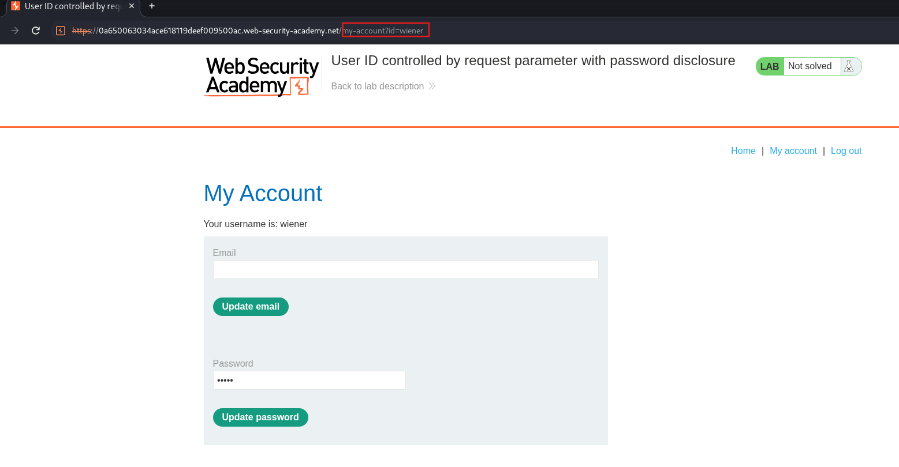
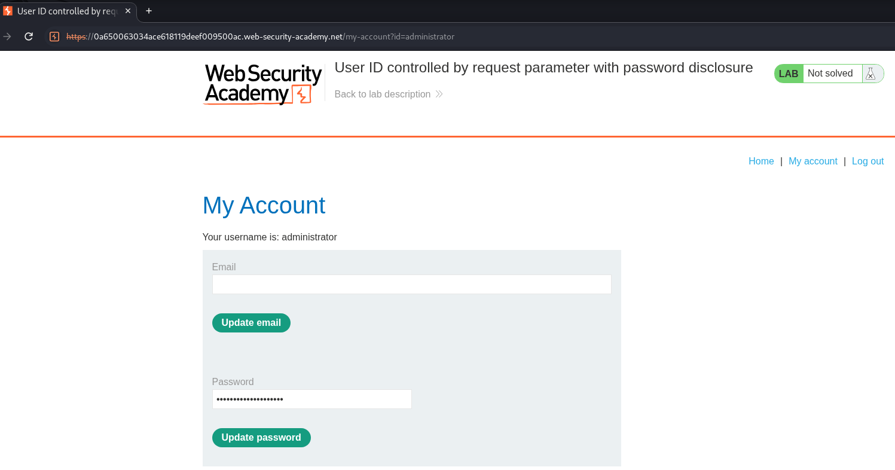
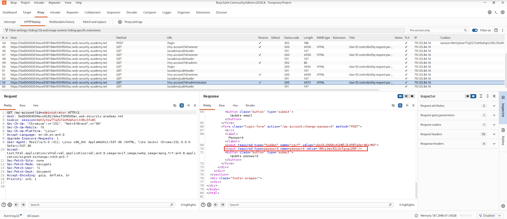

## Lab: User ID Controlled by Request Parameter with Password Disclosure

### Objective

Gain unauthorized administrative access by exploiting user ID manipulation to disclose the administrator's password, then delete the user account `carlos`.

### Vulnerability Analysis

The application uses a user-controlled request parameter to identify account resources. By changing the user ID from `wiener` to `administrator`, an authenticated user can access the administrator's account page. The page exposes the administrator's password through an HTML input field, allowing unauthorized account access.

### Exploitation

#### 1. Login as Wiener

Log in using the provided credentials:

- **Username:** `wiener`
- **Password:** `peter`

Observe that the URL identifies the authenticated user through the parameter `id=wiener`.

#### 2. Modify the Account ID

Change the ID parameter in the URL to `id=administrator`.

#### 3. Inspect the Administrator's HTTP Response

Locate the HTTP request for `/my-account?id=administrator` in Burp Suite HTTP history.

Inspect the HTTP response. The administrator's password is disclosed in the HTML input field's `value` attribute.

#### 4. Login as Administrator

Use the disclosed credentials to log in:

- **Username:** `administrator`
- **Password:** `86cy2qx32i2ofgxgo296`

#### 5. Delete Carlos

Navigate to the administrative panel, locate the user `carlos`, and delete the account.

### Vulnerability

The application fails to enforce proper authorization when accessing account resources through the user ID parameter. This allows authenticated users to access another user's account information.

Additionally, the administrator's password is exposed in the account page's HTML response, resulting in sensitive information disclosure and enabling account compromise.

### Remediation

- Enforce server-side authorization checks for every account resource request.
- Verify that users can only access their own account information unless explicitly authorized.
- Never expose passwords in HTML responses or client-side code.
- Store passwords securely using strong, salted password hashing.
- Apply least-privilege access controls to administrative functionality.

### Key Takeaways

- User-controlled request parameters can introduce IDOR vulnerabilities.
- Accessing another user's account page can expose sensitive information.
- HTML input fields can inadvertently disclose credentials through their `value` attributes.
- Sensitive information disclosure can lead to account compromise and privilege escalation.

### CWE References

- [CWE-639 – Authorization Bypass Through User-Controlled Key](https://cwe.mitre.org/data/definitions/639.html)
- [CWE-862 – Missing Authorization](https://cwe.mitre.org/data/definitions/862.html)
- [CWE-522 – Insufficiently Protected Credentials](https://cwe.mitre.org/data/definitions/522.html)