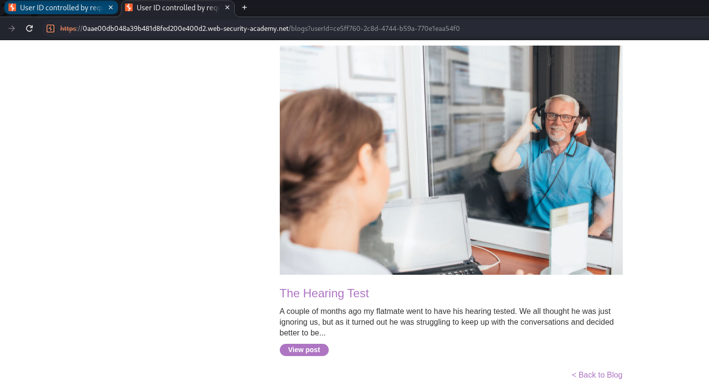
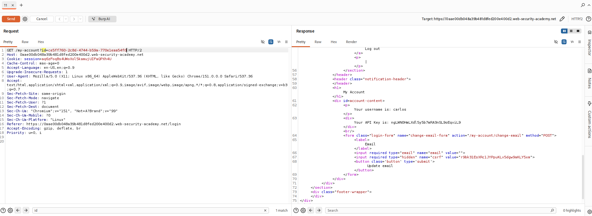
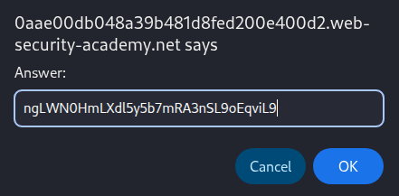

<!-- WVVoU01HTklUVFpNZVRsdVlWaFNiMlJYU1hWWk1qbDBUREkwZEZsWFduQmpWMFYyWkROS2NHUkhWakZqU0UwOQ== -->

## Lab: User ID Controlled by Request Parameter, with Unpredictable User IDs

### Objective

Gain unauthorized access to Carlos's account by identifying his GUID and retrieving his API key.

### Vulnerability Analysis

The application uses a user-controlled request parameter to identify account resources. Although user IDs are unpredictable GUIDs, they are exposed through publicly accessible content. The application fails to verify whether the authenticated user is authorized to access the requested account.

### Exploitation

#### 1. Identify Carlos's User ID

Locate a blog post published by `carlos` and click on his username.

Observe that his user ID is exposed in the URL:

`userId=ce5ff760-2c8d-4744-b59a-770eleaa54f0`

#### 2. Authenticate as Wiener

Log in using the provided credentials:

- **Username:** `wiener`
- **Password:** `peter`

#### 3. Modify the Account ID

Locate the `GET /my-account` request in Burp Suite Proxy HTTP history and send it to Repeater.

Replace the existing account ID with Carlos's user ID:

`id=ce5ff760-2c8d-4744-b59a-770eleaa54f0`

#### 4. Retrieve Carlos's API Key

Send the modified request.

Observe that the response contains Carlos's account information, including his API key.

#### 5. Submit the API Key

Copy Carlos's API key and submit it as the lab solution.

### Vulnerability

The application does not enforce proper object-level authorization. An authenticated user can modify the user ID parameter to access another user's account information.

### Remediation

- Enforce server-side authorization checks for every account resource request.
- Verify that the authenticated user is authorized to access the requested user ID.
- Do not rely on unpredictable identifiers as an access control mechanism.
- Restrict sensitive account information, such as API keys, to the account owner.

### Key Takeaways

- GUIDs do not prevent unauthorized access when authorization checks are missing.
- Publicly accessible content can expose identifiers used in account requests.
- Modifying request parameters can reveal IDOR vulnerabilities.
- Authentication does not guarantee authorization to access other users' resources.

### CWE References

- [CWE-639 – Authorization Bypass Through User-Controlled Key](https://cwe.mitre.org/data/definitions/639.html)
- [CWE-862 – Missing Authorization](https://cwe.mitre.org/data/definitions/862.html)
- [CWE-284 – Improper Access Control](https://cwe.mitre.org/data/definitions/284.html)

---

   Created by <a href="https://github.com/n-afiqa/">@n-afiqa</a> · © 2026.

