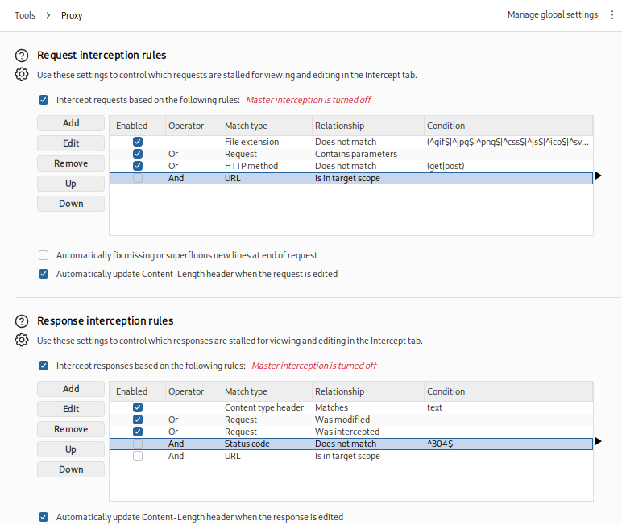

## Lab: User Role Controlled by Request Parameter

### Objective

Modify the session cookie to gain administrative access and delete the user account `carlos`.

### Vulnerability Analysis

The application uses a cookie parameter to determine the user's role. By modifying the cookie value, a user can manipulate their assigned privileges and gain unauthorized administrative access.

### Exploitation

#### 1. Access the Administrative Panel

Navigate to `/admin`.

The application denies access because the current user does not have administrative privileges.

#### 2. Configure Intercept Settings

Locate the `/login` request and configure Burp Suite Proxy interception to capture the login request.

>Ensure the interception settings are configured correctly to capture the required request.

#### 3. Intercept the Login Request

Log in using the provided credentials:

- **Username:** `wiener`
- **Password:** `peter`

#### 4. Modify the Cookie Value

Inspect the intercepted request and locate the cookie parameter controlling the user's role.

Change the `Admin` parameter from `false` to `true`.

#### 5. Forward the Modified Request

Forward the modified request and allow the login process to complete.

#### 6. Access the Administrative Panel

Navigate to `/admin` again. The modified cookie grants access to the administrative functionality.

#### 7. Delete the Target Account

Locate the user `carlos` and delete the account.

### Vulnerability

The application trusts a client-controlled cookie parameter to determine user privileges without properly validating authorization on the server side. This allows users to escalate their privileges by modifying the cookie value.

### Remediation

- Never trust client-controlled cookie values for authorization decisions.
- Enforce role-based access control (RBAC) on the server side.
- Validate user permissions on every privileged request.
- Protect session integrity using server-side session management or cryptographically signed tokens with proper validation.

### Key Takeaways

- Cookies can contain security-sensitive information, including user role attributes.
- Client-controlled parameters can be manipulated to escalate privileges.
- Authentication does not automatically grant authorization.
- Server-side authorization checks are essential to prevent privilege escalation.

### CWE References

- [CWE-639 – Authorization Bypass Through User-Controlled Key](https://cwe.mitre.org/data/definitions/639.html)
- [CWE-862 – Missing Authorization](https://cwe.mitre.org/data/definitions/862.html)
- [CWE-565 – Reliance on Cookies without Validation and Integrity Checking](https://cwe.mitre.org/data/definitions/565.html)