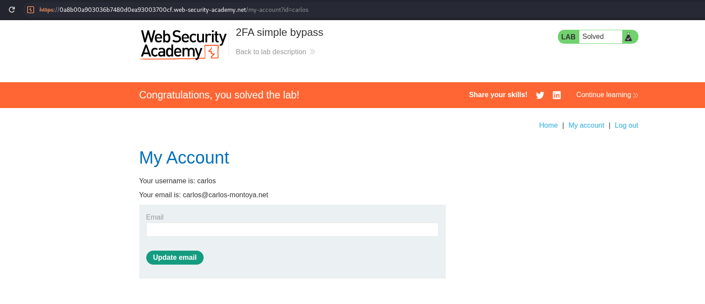

<!-- WVVoU01HTklUVFpNZVRsdVlWaFNiMlJYU1hWWk1qbDBUREkwZEZsWFduQmpWMFYyWkROS2NHUkhWakZqU0UwOQ== -->

## Lab: 2FA Simple Bypass

### Objective

Bypass two-factor authentication (2FA) verification to gain unauthorized access to a user account.

### Vulnerability Analysis

The application does not properly enforce 2FA verification before granting access to authenticated account functionality. This allows users to bypass the verification step by navigating directly to the account page without providing a valid 2FA code.

### Exploitation Steps

#### 1. Login as Carlos

Log in using the provided credentials:

- **Username:** `carlos`
- **Password:** `montoya`

#### 2. Bypass 2FA Verification

When prompted to enter the 2FA code, click **My Account** instead.

The page reloads and grants access to the account without completing 2FA verification.

### Remediation

- Enforce 2FA verification on the server side before granting access to protected resources.
- Validate the authentication state on every protected request.
- Do not rely solely on client-side navigation or page restrictions to enforce authentication steps.
- Maintain a server-side authentication state that distinguishes between password verification and completed 2FA verification.

### Key Takeaways

- 2FA must be enforced server-side.
- Successful password authentication does not mean the authentication process is complete.
- Direct navigation to protected resources can expose authentication workflow weaknesses.
- Every protected request must verify that all required authentication factors have been completed.

### CWE References

- [CWE-287 – Improper Authentication](https://cwe.mitre.org/data/definitions/287.html)
- [CWE-306 – Missing Authentication for Critical Function](https://cwe.mitre.org/data/definitions/306.html)

---

   Created by <a href="https://github.com/n-afiqa/">@n-afiqa</a> · © 2026.

